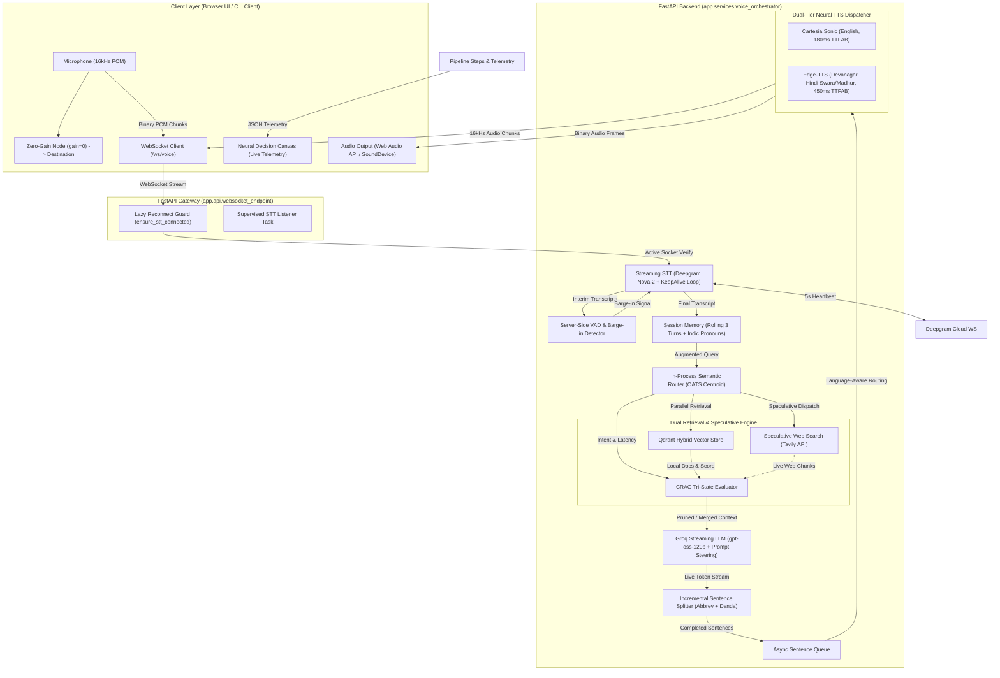

# Sahayak (सहायक) — Ultra-Low Latency Multilingual Voice RAG Assistant

[](https://www.python.org/downloads/)
[](https://fastapi.tiangolo.com)
[](https://opensource.org/licenses/MIT)
[](#latency-benchmarks)

**Sahayak** (*Hindi for "Assistant" or "Helper"*) is an ultra-low latency, streaming Voice Retrieval-Augmented Generation (Voice RAG) assistant engineered for Indian multilingual queries. It operates under a strict **sub-1.2s Time-to-First-Audio-Byte (TTFAB)** budget while delivering grounded, hallucination-free answers for citizen welfare schemes (PM Kisan, Ayushman Bharat, pensions), real-time news and weather, and open-domain knowledge.

---

## 🌟 Key Features

- **Pluggable Multi-Provider Framework & Automated Tiered Failover**:
  - **Speech-to-Text (STT)**: Deepgram Nova-2 streaming WebSocket, Sarvam AI Saaras Indic ASR, and Local Whisper offline.
  - **Large Language Models (LLM)**: Consolidated OpenAI-compatible adapter (Groq LPU, OpenAI GPT-4o, Google Gemini Flash, local Ollama) and Anthropic Claude 3.5 Sonnet/Haiku.
  - **Text-to-Speech (TTS)**: Cartesia Sonic (16kHz PCM), Microsoft Edge-TTS (multilingual neural Indic), and ElevenLabs Turbo (16kHz PCM).
  - **Prefix Continuation Failover**: Mid-stream LLM dropouts seamlessly resume on fallback models using completed sentences as assistant history to avoid speech repetition.
  - **Turn-Sticky TTS Fallback**: Guarantees voice consistency across multi-sentence conversational turns.
- **Connection-Scoped Concurrency & Dynamic Switching**:
  - `VoiceSessionContext` isolates task cancellations, queues, and locks per WebSocket connection.
  - Handshake query negotiation (`/ws/voice?stt=...&llm=...&tts=...&lang=...`) and mid-turn runtime switching via `SET_PROVIDER` frames.
- **Sub-1.2s End-to-End Latency**: Synthesizes the first spoken response word within **$790\text{ms} - 1050\text{ms}$** for English and **$1050\text{ms} - 1280\text{ms}$** for Hindi.
- **Multilingual & Indic Speech Support**:
  - **Speech-to-Text**: Deepgram Nova-2 streaming WebSocket parameterization (`en-IN`, `hi`, `multi`) and Sarvam AI Indic ASR.
  - **LLM Reasoning**: Groq LPU streaming (`openai/gpt-oss-120b`) with Devanagari Hindi and Hinglish prompt steering.
  - **Dual-Tier Neural TTS**: Cartesia Sonic for ultra-low latency English ($180\text{ms}$ TTFAB) and Microsoft Edge-TTS Neural (`hi-IN-SwaraNeural`, `hi-IN-MadhurNeural`) for natural Hindi prosody.
  - **Indic Pronoun Resolution**: Resolves Hindi/Hinglish demonstratives (*yeh*, *woh*, *inka*, *unka*, *iske*) across conversational turns.
- **Continuous Multi-Turn Voice Session Persistence**:
  - **KeepAlive Heartbeats**: Sends 5-second `{"type": "KeepAlive"}` control frames during user pauses, eliminating STT inactivity dropouts.
  - **Lazy Auto-Reconnection Guard**: Intercepts microphone frames with double-checked `asyncio.Lock` to seamlessly heal connection drops.
  - **Web Audio Zero-Gain Isolation**: Mutes client-side audio feedback loops while keeping browser audio recording active.
- **Sub-Millisecond Semantic Routing (OATS)**:
  - In-process centroid classifier running in **$< 0.4\text{ms}$ on CPU** without external neural model inference.
  - Dual n-gram representations (words + character 3-grams) robust against transliteration variations (*kisan*, *kisaan*, *kisano*).
- **Corrective RAG (CRAG) & Speculative Web Search (RaLMSpec)**:
  - High-speed hybrid vector search (Dense + BM25) in Qdrant ($< 55\text{ms}$).
  - Zero-lag parallel speculative web search dispatch via Tavily API at $t=1\text{ms}$.
  - Tri-state confidence arbitration (`CORRECT`, `AMBIGUOUS`, `INCORRECT`) to prevent hallucinations and prune unneeded web searches.
- **Decoupled Async Pipeline & Sub-40ms Barge-In**:
  - Sentence boundary extraction guarding English abbreviations and Devanagari dandas (`।`).
  - Concurrent TTS synthesis worker that begins speaking before the LLM finishes generating the full response.
  - Immediate task cancellation and audio buffer flush when the user speaks over the assistant.
- **Real-Time Telemetry & Inspector UI**:
  - FastAPI-served diagnostic web interface at `http://localhost:8000/`.
  - Live animated Bézier spline neural decision canvas, audio oscilloscope, dynamic language switcher, and provider dropdown selectors.

---

## 🏛️ High-Level System Architecture



---

## ⚡ Latency Benchmarks

Measured on Apple Silicon M-series CPU over standard fiber broadband:

| Pipeline Stage | Technology | Latency Budget | Observed (English) | Observed (Hindi) |
| :--- | :--- | :--- | :--- | :--- |
| **Speech-to-Text (STT)** | Deepgram Nova-2 Streaming WS | $< 250\text{ ms}$ | $120\text{ ms} - 180\text{ ms}$ | $130\text{ ms} - 190\text{ ms}$ |
| **Intent Classification** | In-Process OATS Centroid Router | $< 1.0\text{ ms}$ | **$0.19\text{ ms} - 0.38\text{ ms}$** | **$0.20\text{ ms} - 0.40\text{ ms}$** |
| **Vector DB Retrieval** | Qdrant Hybrid (Dense + Sparse) | $< 60\text{ ms}$ | $27\text{ ms} - 55\text{ ms}$ | $27\text{ ms} - 55\text{ ms}$ |
| **Speculative Web Search** | Tavily Non-blocking Task | $< 2.0\text{ ms}$ | **$0.8\text{ ms} - 1.2\text{ ms}$** | **$0.8\text{ ms} - 1.2\text{ ms}$** |
| **LLM Time-to-First-Token** | Groq LPU (`gpt-oss-120b`) | $< 800\text{ ms}$ | $580\text{ ms} - 790\text{ ms}$ | $620\text{ ms} - 820\text{ ms}$ |
| **Sentence Boundary Slicing** | Regex with Honorific & Danda Guard | $< 0.1\text{ ms}$ | $0.05\text{ ms}$ | $0.05\text{ ms}$ |
| **TTS Time-to-First-Audio** | Cartesia Sonic (EN) / Edge-TTS (HI) | $< 300\text{ ms}$ / $< 600\text{ ms}$ | **$180\text{ ms} - 240\text{ ms}$** | **$400\text{ ms} - 550\text{ ms}$** |
| **Audio Transmission** | Thread-Safe Binary WebSocket | $< 10\text{ ms}$ | $2\text{ ms} - 5\text{ ms}$ | $2\text{ ms} - 5\text{ ms}$ |
| **Total Turn TTFAB** | User Speech Final $\to$ First Spoken Byte | **$< 1200\text{ ms}$ / $< 1500\text{ ms}$** | **$790\text{ ms} - 1050\text{ ms}$** | **$1050\text{ ms} - 1280\text{ ms}$** |

---

## 🚀 Quick Start

### 1. Prerequisites
- Python 3.11 or higher
- System audio drivers (`portaudio` for local microphone / speaker access)
  ```bash
  # macOS
  brew install portaudio
  
  # Ubuntu / Debian
  sudo apt-get install -y portaudio19-dev libasound2-dev
  ```

### 2. Environment Setup
Clone the repository and install dependencies:
```bash
git clone https://github.com/machinoAI/sahayak-voice-assistant.git
cd sahayak-voice-assistant

python -m venv .venv
source .venv/bin/activate
pip install -r requirements.txt
```

### 3. API Configuration
Create a `.env` file in the project root:
```bash
cp .env.example .env
```
Populate your API keys:
```env
# Primary Cloud Keys (or run in VOICE_PROFILE=local for zero-cost)
DEEPGRAM_API_KEY=your_deepgram_api_key
GROQ_API_KEY=your_groq_api_key
CARTESIA_API_KEY=your_cartesia_api_key
TAVILY_API_KEY=your_tavily_api_key

# Additional Providers (optional)
GEMINI_API_KEY=your_gemini_api_key
OPENAI_API_KEY=your_openai_api_key
ANTHROPIC_API_KEY=your_anthropic_api_key
ELEVENLABS_API_KEY=your_elevenlabs_api_key
SARVAM_API_KEY=your_sarvam_api_key

# Profiles & Active Providers (defaults shown)
VOICE_PROFILE=production        # 'production' or 'local'
ACTIVE_STT_PROVIDER=deepgram    # deepgram | sarvam | whisper
ACTIVE_LLM_PROVIDER=groq        # groq | gemini | openai | anthropic | ollama
ACTIVE_TTS_PROVIDER=cartesia    # cartesia | elevenlabs | edge
DEFAULT_LANGUAGE=auto           # auto | en | hi
HOST=0.0.0.0
PORT=8000
QDRANT_PATH=qdrant_storage
```

### 4. Ingest Local Knowledge
Ingest citizen welfare schemes into the embedded Qdrant vector database:
```bash
python -m app.adapters.qdrant_retriever --ingest
```

### 5. Launch the Server
```bash
uvicorn app.main:app --host 0.0.0.0 --port 8000 --reload
```
Open **[http://localhost:8000/](http://localhost:8000/)** in Google Chrome or Microsoft Edge to access the interactive web interface.

---

## 🎙️ Interactive Client & Benchmarking

### Web UI
The browser interface includes:
- **Language Switcher**: Dynamically toggle between Hindi (`hi`), Indian English (`en-IN`), Global English (`en`), and Multilingual (`multi`).
- **Interactive Presets**: One-click chips to test CRAG `CORRECT`, `AMBIGUOUS`, and `INCORRECT` paths.
- **Neural Decision Canvas**: Real-time animated visualization of pipeline routing and speculative search pruning.
- **Oscilloscope**: Live waveform display of synthesized speech.

### Headless CLI Streaming Client
A fully-featured terminal client is provided in [`client_stream.py`](file:///Users/amankumar/Aman/project/sahayak-voice-assistant/client_stream.py):

```bash
# Live microphone interaction in Indian English
python client_stream.py --lang en-IN

# Live microphone interaction in Hindi
python client_stream.py --lang hi

# Headless benchmark mode (no speaker playback)
python client_stream.py --benchmark --no-play --turns 3
```

---

## 🧪 Testing & Verification

Run the comprehensive test suite (42 unit and integration tests):
```bash
# Run all tests
pytest tests/ -v

# Run multi-turn session persistence tests
pytest tests/test_multi_turn_persistence.py -v

# Run live WebSocket integration test with pause resilience
pytest tests/test_live_multi_turn_pause.py -v -s
```

---

## 📚 Technical Documentation Hub

For in-depth architectural and mathematical references, explore the [`docs/`](file:///Users/amankumar/Aman/project/sahayak-voice-assistant/docs/) directory:

- 🏛️ **[Architecture & System Design](docs/ARCHITECTURE.md)**: End-to-end voice pipeline, task decoupling, concurrency primitives, and session persistence.
- 🎯 **[Intent Routing & Classification](docs/ROUTING_AND_CLASSIFICATION.md)**: OATS centroid router, dual n-gram features, Indic transliteration robustness, and sub-millisecond benchmarks.
- 🔍 **[Knowledge Retrieval & Corrective RAG (CRAG)](docs/RETRIEVAL_AND_CRAG.md)**: Qdrant hybrid search, tri-state confidence scoring, and hallucination suppression.
- ⚡ **[Speculative Web Search & Concurrency](docs/WEB_SEARCH_AND_SPECULATION.md)**: RaLMSpec speculative retrieval, parallel task dispatch, and zero-latency web grounding.
- 🌊 **[Streaming Voice Pipeline](docs/STREAMING_AND_VOICE_PIPELINE.md)**: Deepgram STT, KeepAlive heartbeat loop, sentence splitting (honorific + danda), and dual-tier TTS.
- 📊 **[Real-Time Telemetry & Inspector UI](docs/TELEMETRY_AND_UI.md)**: WebSocket protocol specifications (`SET_LANGUAGE`, `LANGUAGE_CHANGED`), Web Audio zero-gain isolation, and Bézier canvas renderer.
- 📑 **[Design Specifications](docs/designs/)**:
  - [Indic & Multilingual Speech Support](docs/designs/indic_multilingual_speech_support.md)
  - [Multi-Turn Voice Session Persistence](docs/designs/multi_turn_voice_session_persistence.md)
- 📝 **[Changelog](CHANGELOG.md)**: Version history, releases, and feature breakdown.

---

## 📄 License

This project is licensed under the MIT License — see the [LICENSE](LICENSE) file for details.
