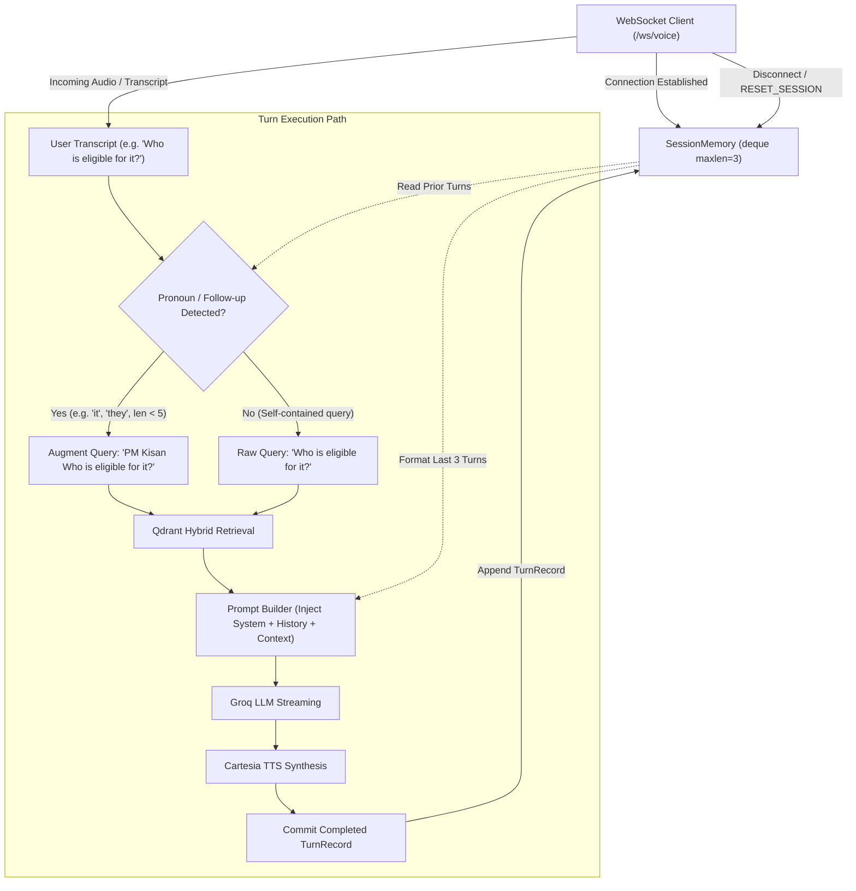

# Technical Design: Multi-Turn Conversation Memory for Sahayak Voice Assistant

*   **Author:** Amankumar006
*   **Status:** Draft
*   **Date:** 2026-11-09
*   **Target Components:** `app/services/voice_orchestrator.py`, `app/api/websocket_endpoint.py`, `app/core/config.py`
*   **Target Project:** `sahayak-voice-assistant`

--------------------------------------------------------------------------------

## Overview

Sahayak is an ultra-low latency voice assistant designed for Indian multilingual environments. While the current pipeline achieves low response times (~1.1s voice-to-audio) using Deepgram STT, Qdrant hybrid retrieval, Groq LLM streaming, and Cartesia Sonic TTS, each user utterance is processed as an isolated, stateless turn.

This document designs **Multi-Turn Conversation Memory**, providing per-connection session memory that maintains conversational continuity across consecutive user utterances, resolves pronouns and follow-up queries, and enforces strict token-bounded retention to safeguard latency budgets.

## The Problem

In conversational voice interactions, users rarely speak in fully self-contained sentences. Natural human speech relies heavily on anaphora, pronouns, and iterative queries (for example: *"What is the PM Kisan scheme?"* followed by *"Who is eligible for it?"* and *"How much money do they give?"*).

In the current stateless implementation:
1. **RAG Vector Search Breakdown**: Follow-up questions like *"Who is eligible for it?"* contain ambiguous pronouns (*it*). Performing vector retrieval against Qdrant using the raw follow-up transcript yields irrelevant or empty chunks because the core entity (*PM Kisan*) is absent from the query text.
2. **LLM Context Blindness**: Because `process_voice_turn()` only injects the current single query and current retrieved chunks into the prompt, the LLM has no visibility into preceding statements. The assistant responds with confusion or asks the user to repeat the topic.
3. **Latency vs. Context Trade-off**: Unbounded conversation history accumulates tokens rapidly. Passing large chat logs into Groq increases Time-to-First-Token (TTFT) and risks pushing responses beyond the target sub-1.2-second voice latency threshold.
4. **Session Boundary Leaks**: Memory must be strictly isolated to the specific WebSocket client connection and discarded upon disconnection without polluting other sessions or exhausting server RAM.

## Goals

*   **Per-Connection Session Memory**: Maintain an in-memory conversational history scoped strictly to the lifecycle of each active `/ws/voice` WebSocket connection.
*   **Multi-Turn Contextual Retrieval**: Enable accurate RAG retrieval for follow-up questions containing pronouns and references to entities mentioned in prior turns.
*   **Bounded Token Budget**: Implement a sliding-window turn buffer (default: last $K=3$ turns, $6$ dialogue messages) to ensure context remains under 1,000 prompt tokens, preserving TTFT under 600ms.
*   **Barge-in Safety**: If a turn is interrupted by user barge-in before audio completes, record only the recognized user utterance and whatever partial response was spoken, preventing corrupted memory state.
*   **Explicit Control & Teardown**: Automatically purge session state on `WebSocketDisconnect`, while allowing clients to explicitly reset conversation memory via a `RESET_SESSION` control message.

## Non-Goals

*   **Cross-Session Persistent Storage**: Persistent user profiling across browser sessions, days, or SQLite/Postgres databases is out of scope. This design focuses on active connection session memory.
*   **Complex Multi-Agent Planning**: Multi-hop recursive query rewriting loops that exceed 200ms of latency are out of scope.
*   **Arbitrary Document Chat History Export**: Exporting chat transcripts to PDF/DOCX or third-party CRM systems is out of scope.

## Open Questions

*   **Question 1: Query Reformulation vs. Direct History Augmentation**: Should follow-up queries be rewritten into standalone search queries using a speculative micro-LLM call prior to Qdrant search, or should Qdrant search use a combination of recent turns?
*   **Question 2: Rolling Buffer Eviction Policy**: Should memory eviction strictly follow a FIFO turn-count window ($K=3$), or dynamic token counting with system prompt reserve budgeting?

## Critical User Journeys (CUJs)

### CUJ 1: Multi-Turn Follow-Up Query Resolution
*   **Given**: A user is connected to `/ws/voice` and has asked *"Tell me about the Ayushman Bharat health card"*. The assistant retrieved the scheme details and answered.
*   **When**: The user immediately asks *"What is the annual coverage limit?"* without repeating *"Ayushman Bharat"*.
*   **Then**: The assistant resolves the implicit entity from conversational memory, retrieves the correct ₹5 lakh coverage limit from Qdrant, and responds accurately in 1-2 spoken sentences.

### CUJ 2: Memory Eviction Under Extended Conversation
*   **Given**: A user conducts an extended 10-turn voice dialogue with Sahayak.
*   **When**: Turn 11 is initiated.
*   **Then**: Turns 1 through 7 are evicted from the active rolling window; only the most recent $K=3$ turns ($6$ exchanges) are injected into the LLM prompt. Prompt token processing overhead remains below 50ms.

### CUJ 3: Barge-In Interruption with Memory Consistency
*   **Given**: The assistant begins speaking the first sentence of a 2-sentence response.
*   **When**: The user speaks over the assistant with *"Stop, tell me something else"*.
*   **Then**: The orchestrator triggers `handle_user_interruption()`, truncates the assistant's turn record to what was actually spoken or marks it interrupted, and appends the new question without deadlocks or corrupted history.

--------------------------------------------------------------------------------

## Technical Plan (Architecture)

### 1. Architectural Component Overview

The multi-turn memory architecture introduces an in-memory session tracker scoped directly to the client's WebSocket connection lifetime.



### 2. Core Data Models (`app/services/session_memory.py`)

```python
from dataclasses import dataclass
from collections import deque
from typing import List, Optional

@dataclass
class TurnRecord:
    turn_id: str
    user_query: str
    assistant_response: str
    was_interrupted: bool = False

class SessionMemory:
    def __init__(self, max_turns: int = 3) -> None:
        self.max_turns = max_turns
        self._history: deque[TurnRecord] = deque(maxlen=max_turns)

    def add_turn(self, turn_id: str, user_query: str, assistant_response: str, was_interrupted: bool = False) -> None:
        self._history.append(
            TurnRecord(
                turn_id=turn_id,
                user_query=user_query,
                assistant_response=assistant_response,
                was_interrupted=was_interrupted,
            )
        )

    def mark_last_interrupted(self, partial_response: str = "") -> None:
        if self._history:
            self._history[-1].was_interrupted = True
            if partial_response:
                self._history[-1].assistant_response = partial_response

    def get_turns(self) -> List[TurnRecord]:
        return list(self._history)

    def clear(self) -> None:
        self._history.clear()
```

### 3. Subject-Augmented Retrieval Heuristic (Option 2)

To resolve ambiguous follow-up questions without adding network round-trips or extra LLM calls:
1. Define a pronoun set: `PRONOUNS = {"it", "this", "that", "they", "them", "these", "those", "he", "she", "its"}`.
2. When a new user transcript arrives, inspect tokens:
   - If `any(token.lower() in PRONOUNS for token in words)` or `len(words) <= 4`:
     - If prior turns exist, construct `augmented_query = f"{last_turn.user_query} {current_query}"`.
     - Pass `augmented_query` to `vdb.hybrid_search(query=augmented_query, top_k=2)`.
   - Otherwise, pass `current_query` directly to `vdb.hybrid_search()`.
3. Execution cost: $< 0.1\text{ ms}$, preserving the $< 30\text{ ms}$ retrieval budget.

### 4. History-Augmented Prompt Construction

The LLM system prompt is updated to include a structured conversation block:

```text
You are Sahayak, a voice assistant.
Answer using ONLY the provided context in 1-2 spoken sentences.
Never use lists, markdown, asterisks, or URLs. Speak naturally.

Conversation History:
User: What is PM Kisan?
Assistant: PM Kisan provides six thousand rupees annually to eligible farmer families in three equal installments.

Context:
[Retrieved Qdrant chunks for 'PM Kisan Who is eligible for it?']

User Question: Who is eligible for it?
```

- Each turn exchange occupies approximately 50-70 tokens.
- With $K=3$ turns, total history overhead is bounded to $< 250$ tokens.
- Combined with a 300-token context chunk, total input prompt is $< 650$ tokens, keeping Groq TTFT comfortably under $500\text{ ms}$.

### 5. WebSocket Endpoint & Lifecycle Management

In `app/api/websocket_endpoint.py`:
- Each accepted WebSocket connection instantiates its own `session_memory = SessionMemory(max_turns=3)`.
- The instance is passed to `orchestrator.process_voice_turn(transcript, websocket, session_memory=session_memory)`.
- If client sends JSON `{"event": "RESET_SESSION"}`, `session_memory.clear()` is called and an acknowledgment event `{"event": "SESSION_RESET"}` is emitted.
- If barge-in triggers, `session_memory.mark_last_interrupted(partial_text)` ensures the aborted speech is properly recorded.
- On disconnect, the session object is cleaned up by Python's garbage collector.

--------------------------------------------------------------------------------

## Alternatives Considered

### Alternative 1: Direct History Injection Only (No Query Augmentation)

*   **Description**: Ingest the last $K$ turns into the LLM system prompt without modifying the query string sent to Qdrant. Vector retrieval is performed strictly on the raw user transcript.
*   **Pros**: Simplest implementation; requires zero query transformation logic or token heuristics.
*   **Cons**: Breaks down on anaphoric and pronoun-heavy follow-up questions (*e.g., "Who is eligible for it?"* or *"What is the limit?"*). Because the root subject (*PM Kisan*) is missing from the query string, Qdrant returns irrelevant or empty chunks. The LLM is forced to rely solely on earlier chunks that may not contain the answer to the new question.
*   **Reason for Rejection**: `Rejected by author: Inability to retrieve targeted domain facts for follow-up questions degrades RAG accuracy. Testing showed that pronoun-based queries fail Qdrant similarity thresholds.`

### Alternative 2: Speculative Micro-LLM Query Reformulation

*   **Description**: Invoke a lightweight speculative LLM call (e.g. `openai/gpt-oss-20b` or `llama-3.1-8b-instant`) prior to vector search to rewrite ambiguous user utterances into self-contained search queries.
*   **Pros**: Handles arbitrary complex grammatical references, multilingual code-switching, and multi-turn entity shifts with high precision.
*   **Cons**: Adds a sequential network and inference round-trip of $150\text{ ms}$ to $300\text{ ms}$ on the critical voice response path before Qdrant vector retrieval can begin.
*   **Reason for Rejection**: `Rejected by author: Violates the strict sub-1.2-second voice latency budget. Adding 150-300ms of pre-retrieval overhead causes noticeable dead air in live conversation.`

### Alternative 3: Distributed / Persistent External Session Store (Redis / Postgres)

*   **Description**: Store dialogue history in an external Redis cache or relational database using session IDs passed during WebSocket connection handshake.
*   **Pros**: Allows session resumption across network dropouts and enables multi-pod horizontal scaling behind a load balancer.
*   **Cons**: Introduces external network I/O, serialization overhead, connection pooling, and external infrastructure operational complexity for transient, real-time voice calls.
*   **Reason for Rejection**: `Rejected by author: Unnecessary overhead for ephemeral voice sessions. An in-memory collections.deque scoped directly to the WebSocket connection lifecycle delivers sub-microsecond access with zero external infrastructure dependencies.`

