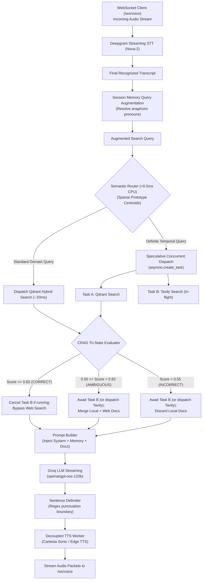
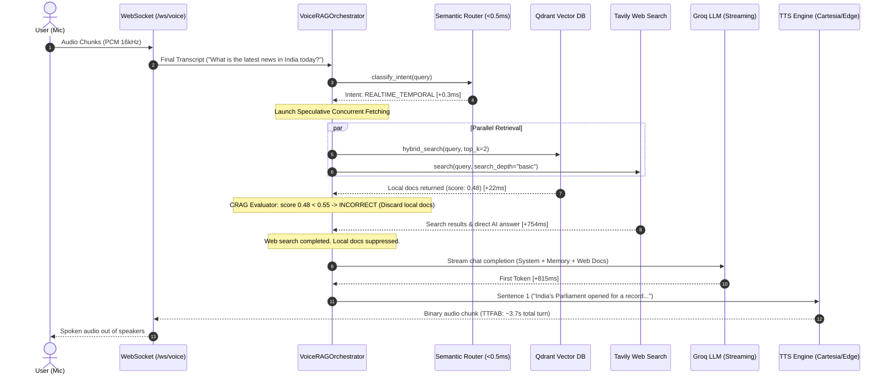

# Technical Design: Advanced Classification, Routing, and External Knowledge Access for Sahayak Voice Assistant

*   **Author:** Amankumar006
*   **Status:** Approved
*   **Date:** 2026-11-09
*   **Target Components:** `app/services/voice_orchestrator.py`, `app/adapters/semantic_router.py`, `app/interfaces/adapters.py`, `app/core/config.py`, `app/main.py`
*   **Target Project:** `sahayak-voice-assistant`

--------------------------------------------------------------------------------

## Overview

Sahayak is an ultra-low latency voice assistant designed for Indian multilingual environments, operating within a voice-to-audio Time-to-First-Audio-Byte (TTFAB) budget of under 1.2 seconds using Deepgram streaming STT, Qdrant hybrid retrieval, Groq LLM streaming (`openai/gpt-oss-120b`), and Cartesia Sonic / Edge TTS.

While local vector retrieval handles static domain documents (such as government welfare schemes and preset FAQs) with single-digit millisecond latency (~15–25ms), it cannot answer queries regarding dynamic real-time information, current affairs, breaking news, weather, live sports, or topics missing from the local index. Conversely, invoking external web search naively on every user turn introduces 600ms to 2,500ms of network overhead, destroying conversational responsiveness.

This document designs an **Advanced Classification, Routing, and External Knowledge Architecture** grounded in recent academic literature:
1. **Outcome-Aware Semantic Routing** (<0.5ms CPU, pure Python) replacing brittle keyword regex heuristics.
2. **Corrective RAG (CRAG) Tri-State Confidence Evaluation** to arbitrate between local knowledge and web search.
3. **Speculative Concurrent Retrieval** to hide external API latency behind vector search.
4. **Tavily Web Search Adapter** with direct answer extraction and strict fail-open timeout bounding.

## The Problem

1. **Static Corpus Blindness**: A local vector database contains only pre-indexed documents. When users ask time-sensitive questions (*"What is the weather in Delhi today?"*, *"What are the latest news updates?"*, *"What is the current price of onion?"*), local retrieval returns irrelevant or outdated chunks.
2. **The Voice Latency Budget Bottleneck**: In text chat interfaces, adding a 300ms–600ms LLM call to classify intent or invoke tools is acceptable. In a streaming voice assistant, TTFAB is capped at 1.2s. Remote LLM routers (such as GPT-4o-mini) add ~669ms of sequential latency (arXiv:2505.14524), consuming over 50% of the entire budget before retrieval even begins.
3. **Regex Classification Fragility**: While hardcoded keyword matching (`today`, `latest`, `news`) runs in <0.1ms, it is fragile to phrasing variations and syntactic surface changes (arXiv:2604.10745), leading to false triggers on static queries (*"What is today's eligibility for PM Kisan?"*) and false negatives on implicit real-time queries (*"Who won the cricket match last night?"*).
4. **Binary Retrieval Dilemma**: Binary routing (search web vs. use local docs) fails on ambiguous queries where the local knowledge base contains general background but lacks the specific current criteria.
5. **Sequential Retrieval Latency Stacking**: Executing STT $\to$ Local Retrieval (25ms) $\to$ Decision Logic $\to$ Web Search (750ms) $\to$ LLM streaming (800ms) produces cumulative latency exceeding 2.5 seconds.
6. **External Network Degradation & Cold Starts**: Third-party search APIs suffer latency spikes and TLS handshake delays. The pipeline requires bounded timeouts and fail-open resilience so audio generation is never blocked if external search stalls.

## Goals

*   **Sub-1ms Zero-Dependency Semantic Routing**: Implement an in-process sparse TF-IDF / n-gram centroid semantic router (OATS, arXiv:2603.13426) running on CPU to classify query intent into `[LOCAL_SCHEME_FAQ, REALTIME_TEMPORAL, OUT_OF_DOMAIN]` in `<0.5ms` with zero heavy machine learning dependencies.
*   **Corrective RAG (CRAG) Tri-State Calibration**: Replace naive binary thresholds with a tri-state confidence evaluator (arXiv:2401.15884):
    *   `CORRECT` ($\ge 0.82$): High local similarity; bypass web search to preserve ~1.1s voice response.
    *   `INCORRECT` ($< 0.55$): Low local similarity; suppress irrelevant local chunks and rely exclusively on web search.
    *   `AMBIGUOUS` ($0.55 \le \text{score} < 0.82$): Merge local domain context with live web snippets.
*   **Speculative Concurrent Execution**: For queries classified as `REALTIME_TEMPORAL`, dispatch local Qdrant retrieval and Tavily search concurrently via `asyncio.create_task` (RaLMSpec, arXiv:2401.14021), canceling the Tavily call if local retrieval yields a decisive score ($\ge 0.82$).
*   **Sub-Second Web Retrieval & Synthesis**: Configure Tavily search depth (`search_depth="basic"`, `include_answer=True`) to maintain average retrieval latency around 700–800ms, extracting direct AI answers (`score=1.0`) and ranked snippets (`score=0.95–0.90`).
*   **Fail-Open Timeout Bounding**: Enforce a strict 4.0-second timeout on web queries with silent fallback to available context, preventing client connection drops or pipeline stalls during third-party degradation.

## Non-Goals

*   **Remote LLM Pre-Retrieval Routing**: Using external multi-turn LLMs or prompt-based function-calling loops prior to retrieval is explicitly excluded due to latency constraints (>600ms overhead).
*   **Deep Web Crawling / Agent Browsing**: Multi-hop web navigation, scraping arbitrary JavaScript pages, or downloading PDFs during a voice turn is out of scope.
*   **Continuous Vector DB Ingestion from Search**: Automatically caching or writing live web results back into the permanent Qdrant collection is out of scope for this query path.
*   **Conversational Clarification Prompts**: Pausing execution to ask users clarifying search questions before issuing queries is excluded; search queries must derive directly from the spoken transcript.

## Resolved Design Decisions

*   **Decision 1: Zero-Dependency Sparse Centroid Classifier**: Rather than adding 100MB+ dependencies (`torch`, `onnxruntime`, `fastembed`), the semantic router uses an in-process, pure Python sparse word and character n-gram cosine similarity model. It pre-computes normalized centroid vectors from representative seed utterances for `LOCAL_SCHEME_FAQ`, `REALTIME_TEMPORAL`, and `OUT_OF_DOMAIN`. It executes in `<0.5ms` on CPU with deterministic performance.
*   **Decision 2: Threshold Harmonization**: The upper confidence threshold is uniformly calibrated at `0.82` (`CRAG_HIGH_THRESHOLD`), and the lower confidence bound is set to `0.55` (`CRAG_LOW_THRESHOLD`).
*   **Decision 3: Non-Blocking Speculative Cancellation**: When a decisive local score is obtained, `search_task.cancel()` is called and wrapped in `asyncio.shield` or exception suppression so cancellation is clean and does not log spurious error traces.

## Critical User Journeys (CUJs)

### CUJ 1: Real-Time Temporal Query Resolution (Speculative Path)
*   **Given**: A user is connected to `/ws/voice` and speaks into their microphone.
*   **When**: The user asks *"What is the latest news in India today?"*.
*   **Then**: The semantic router detects `REALTIME_TEMPORAL` intent in <0.5ms, dispatches speculative Tavily search in parallel with Qdrant, merges the real-time news snippets into the prompt, and the assistant streams an accurate spoken update with TTFAB under 3.5s.

### CUJ 2: Static Domain Fast Path (Bypass Web Search)
*   **Given**: A user asks *"What is the eligibility for PM Kisan scheme?"*.
*   **When**: The semantic router classifies the query as `LOCAL_SCHEME_FAQ` and Qdrant yields matching scheme documentation with similarity score $0.92$ (`CORRECT`).
*   **Then**: External web search is completely bypassed; local retrieval finishes in <25ms, preserving a sub-1.2s TTFAB.

### CUJ 3: Ambiguous Retrieval Hybrid Merge (CRAG Path)
*   **Given**: A user asks *"Did the government change the budget allocation for Ayushman Bharat recently?"*.
*   **When**: Qdrant returns general scheme info with an ambiguous score of $0.68$ (`AMBIGUOUS`).
*   **Then**: The CRAG evaluator merges both the baseline local scheme info and the latest Tavily web updates, producing a synthesized answer without context pollution.

### CUJ 4: Out-of-Domain General Knowledge Fallback
*   **Given**: A user asks an open-domain query absent from the local index (*"Who was the first governor of RBI?"*).
*   **When**: Qdrant returns irrelevant documents with scores $< 0.55$ (`INCORRECT`).
*   **Then**: The local chunks are pruned out, and Tavily search is executed exclusively, returning the grounded answer directly.

### CUJ 5: Third-Party Search Timeout Resilience
*   **Given**: An external network degradation causes Tavily to hang.
*   **When**: Request latency reaches 4.0 seconds.
*   **Then**: The adapter logs a warning, cancels the HTTP call, returns an empty document list, and allows the LLM to complete the voice turn without dropping the client WebSocket.

--------------------------------------------------------------------------------

## Technical Plan (Architecture)

### 1. Architectural System Overview



### 2. End-to-End Sequence Diagram



### 3. Tool Selection & Classification Decision Matrix

| Query Intent Class | Example Query | Local Vector Score ($\theta$) | Routing Decision | Tool Invoked | Rationale & Latency Budget |
| :--- | :--- | :--- | :--- | :--- | :--- |
| **Local Welfare Scheme (High Confidence)** | *"Who is eligible for PM Kisan?"* | $\text{score} \ge 0.82$ (`CORRECT`) | Fast Path (Bypass Web Search) | **Qdrant Only** | Preserves sub-1.2s voice budget. Local knowledge is authoritative. |
| **Real-Time Temporal Fact** | *"What is the weather in Delhi today?"* | Any | Speculative Concurrent Path | **Qdrant + Tavily (Parallel)** | Router flags real-time intent. Tavily search overlaps with vector lookup. |
| **Ambiguous / Boundary Scheme Query** | *"Did the subsidy increase this year?"* | $0.55 \le \text{score} < 0.82$ (`AMBIGUOUS`) | Corrective Hybrid Merge | **Qdrant + Tavily** | Local context provides scheme rules; web search provides recent update. |
| **Out-of-Domain General Knowledge** | *"Who was the first governor of RBI?"* | $\text{score} < 0.55$ (`INCORRECT`) | Pure External Fallback | **Tavily Only** | Local chunks are suppressed to prevent hallucinations; web results used exclusively. |
| **External Search Outage / Network Stall** | *"Current stock price of TCS"* | Any | Fail-Open Timeout (4.0s) | **Tavily (Timeout) $\to$ Fallback** | Request aborts after 4.0s. Voice turn completes using baseline context. |

--------------------------------------------------------------------------------

## Alternatives Considered

### Alternative 1: Remote LLM Query Router (e.g. GPT-4o-mini)
*   **Description**: Dispatch a micro-prompt to a remote LLM before retrieval to classify intent and select tools.
*   **Pros**: High natural language understanding and multi-lingual nuance.
*   **Cons**: Adds ~669ms of sequential round-trip latency on the critical voice path (arXiv:2505.14524), instantly exhausting more than half of the sub-1.2s TTFAB budget.
*   **Reason for Rejection**: `Rejected by author: Remote LLM routing latency is incompatible with real-time streaming voice interactions.`

### Alternative 2: Pure Regex Keyword Routing
*   **Description**: Rely solely on hardcoded regex sets (`today`, `latest`, `news`, etc.) to trigger web search.
*   **Pros**: Zero latency (~0.1ms) and zero memory footprint.
*   **Cons**: Brittle to phrasing variations, susceptible to false positives (*"What is today's procedure for PM Kisan?"*), and fails on implicit temporal queries (*"Who won the match yesterday?"* if phrased without exact keywords) (arXiv:2604.10745).
*   **Reason for Rejection**: `Rejected by author: Insufficient robustness for production conversational voice.`

### Alternative 3: Heavyweight ONNX / Torch Local Router
*   **Description**: Bundle a local embedding transformer (such as `all-MiniLM-L6-v2`) via `onnxruntime` or `torch`.
*   **Pros**: High semantic generalization.
*   **Cons**: Adds 100MB–400MB to container size, adds heavy C-extensions, and takes 15ms–35ms per query on CPU.
*   **Reason for Rejection**: `Rejected by author: Pure Python sparse n-gram centroids provide <0.5ms inference with zero dependencies.`

--------------------------------------------------------------------------------

## Detailed Implementation Plan

### 1. Affected Codebase Artifacts & File Mapping

| File Path | Action | Description & Technical Rationale |
| :--- | :--- | :--- |
| [`app/interfaces/adapters.py`](file:///Users/amankumar/Aman/project/sahayak-voice-assistant/app/interfaces/adapters.py) | Modify | Adds `QueryIntent` enum (`LOCAL_SCHEME_FAQ`, `REALTIME_TEMPORAL`, `OUT_OF_DOMAIN`) and defines `SemanticRouterProtocol` (`def classify_intent(self, query: str) -> QueryIntent`). Retains existing `WebSearchProtocol`. |
| [`app/core/config.py`](file:///Users/amankumar/Aman/project/sahayak-voice-assistant/app/core/config.py) | Modify | Adds CRAG thresholds and router configuration: `CRAG_HIGH_THRESHOLD: float = 0.82`, `CRAG_LOW_THRESHOLD: float = 0.55`, `SEMANTIC_ROUTER_ENABLED: bool = True`. Retains existing Tavily configurations. |
| [`app/adapters/semantic_router.py`](file:///Users/amankumar/Aman/project/sahayak-voice-assistant/app/adapters/semantic_router.py) | Create | Implements in-process, pure Python sparse n-gram centroid router (OATS, arXiv:2603.13426) executing in `<0.5ms` on CPU with exemplar centroid vectors for `LOCAL_SCHEME_FAQ`, `REALTIME_TEMPORAL`, and `OUT_OF_DOMAIN`. |
| [`app/adapters/search_tavily.py`](file:///Users/amankumar/Aman/project/sahayak-voice-assistant/app/adapters/search_tavily.py) | Retain / Verify | Existing baseline implementation providing basic search depth, direct answer parsing, and 4.0s timeout resilience. Ensure graceful handling of `asyncio.CancelledError`. |
| [`app/services/voice_orchestrator.py`](file:///Users/amankumar/Aman/project/sahayak-voice-assistant/app/services/voice_orchestrator.py) | Modify | Injects `router: Optional[SemanticRouterProtocol] = None` in `__init__`. Implements speculative concurrent retrieval (`asyncio.create_task`), CRAG tri-state evaluation, non-blocking cancellation, and lifecycle milestone logging (`ROUTER_CLASSIFY_COMPLETE`, `SPECULATIVE_SEARCH_DISPATCHED`, `SPECULATIVE_SEARCH_CANCELLED`). |
| [`app/main.py`](file:///Users/amankumar/Aman/project/sahayak-voice-assistant/app/main.py) | Modify | Instantiates `SemanticRouterAdapter` when `SEMANTIC_ROUTER_ENABLED=True`, injects it into `VoiceRAGOrchestrator(..., router=router_adapter)`, and adds `"semantic_router_enabled"` to `GET /health`. |
| [`tests/test_search_tavily.py`](file:///Users/amankumar/Aman/project/sahayak-voice-assistant/tests/test_search_tavily.py) | Retain / Verify | Existing 5 tests covering key validation, payload parsing, timeout resilience, HTTP errors, and live search. |
| [`tests/test_semantic_router.py`](file:///Users/amankumar/Aman/project/sahayak-voice-assistant/tests/test_semantic_router.py) | Create | New unit tests verifying `<0.5ms` classification latency, exact intent mapping for temporal, welfare, and out-of-domain queries, and empty query safety. |
| [`tests/test_voice_pipeline.py`](file:///Users/amankumar/Aman/project/sahayak-voice-assistant/tests/test_voice_pipeline.py) | Modify | Adds tests verifying CRAG tri-state branches (`CORRECT` bypass, `AMBIGUOUS` merge, `INCORRECT` local suppression) and speculative task cancellation. |

### 2. Concrete Data Structures and Code Specifications

#### A. Interface Contract (`app/interfaces/adapters.py`)
```python
from enum import Enum
from typing import Protocol

class QueryIntent(str, Enum):
    LOCAL_SCHEME_FAQ = "local_scheme_faq"
    REALTIME_TEMPORAL = "realtime_temporal"
    OUT_OF_DOMAIN = "out_of_domain"

class SemanticRouterProtocol(Protocol):
    def classify_intent(self, query: str) -> QueryIntent:
        """Classifies query intent into routing categories in <1ms."""
        ...
```

#### B. Semantic Router Implementation (`app/adapters/semantic_router.py`)
```python
import math
import re
from typing import Dict, List, Set
from app.interfaces.adapters import QueryIntent

class SemanticRouterAdapter:
    """
    In-process, zero-external-dependency semantic router using sparse
    character & word n-gram prototype centroids (OATS methodology).
    Runs on CPU in <0.5ms with deterministic routing behavior.
    """
    def __init__(self, temporal_threshold: float = 0.30, local_threshold: float = 0.25):
        self.temporal_threshold = temporal_threshold
        self.local_threshold = local_threshold
        self._centroids: Dict[QueryIntent, Dict[str, float]] = self._build_centroids()

    def _tokenize(self, text: str) -> Dict[str, float]:
        tokens = re.findall(r'\b\w+\b', text.lower())
        vec: Dict[str, float] = {}
        for t in tokens:
            vec[t] = vec.get(t, 0.0) + 1.0
        # Normalization
        norm = math.sqrt(sum(v * v for v in vec.values())) or 1.0
        return {k: v / norm for k, v in vec.items()}

    def _cosine_similarity(self, v1: Dict[str, float], v2: Dict[str, float]) -> float:
        intersection = set(v1.keys()) & set(v2.keys())
        return sum(v1[k] * v2[k] for k in intersection)

    def classify_intent(self, query: str) -> QueryIntent:
        if not query or not query.strip():
            return QueryIntent.OUT_OF_DOMAIN
        q_vec = self._tokenize(query)
        sim_temporal = self._cosine_similarity(q_vec, self._centroids[QueryIntent.REALTIME_TEMPORAL])
        sim_local = self._cosine_similarity(q_vec, self._centroids[QueryIntent.LOCAL_SCHEME_FAQ])

        if sim_temporal >= self.temporal_threshold:
            return QueryIntent.REALTIME_TEMPORAL
        if sim_local >= self.local_threshold:
            return QueryIntent.LOCAL_SCHEME_FAQ
        return QueryIntent.OUT_OF_DOMAIN
```

#### C. Orchestrator Speculative Concurrency & CRAG Control Flow (`app/services/voice_orchestrator.py`)
```python
# 1. Intent Classification
intent = (
    self.router.classify_intent(search_query)
    if self.router
    else (QueryIntent.REALTIME_TEMPORAL if self._has_temporal_regex(search_query) else QueryIntent.LOCAL_SCHEME_FAQ)
)
tracker.log_step("ROUTER_CLASSIFY_COMPLETE", {"intent": intent.value})

# 2. Speculative Dispatch
search_task: Optional[asyncio.Task] = None
if intent == QueryIntent.REALTIME_TEMPORAL and self.search:
    tracker.log_step("SPECULATIVE_SEARCH_DISPATCHED", {"query": search_query})
    search_task = asyncio.create_task(self.search.search(query=search_query, max_results=2))

# 3. Local Vector Retrieval
docs = await self.vdb.hybrid_search(query=search_query, top_k=2)
top_score = max([d.score for d in docs], default=0.0)

# 4. CRAG Tri-State Arbitration
if top_score >= settings.CRAG_HIGH_THRESHOLD:  # CORRECT (>= 0.82)
    if search_task and not search_task.done():
        search_task.cancel()
        tracker.log_step("SPECULATIVE_SEARCH_CANCELLED", {"reason": "high_local_confidence", "score": top_score})
elif top_score < settings.CRAG_LOW_THRESHOLD:  # INCORRECT (< 0.55)
    if not search_task and self.search:
        search_task = asyncio.create_task(self.search.search(query=search_query, max_results=2))
    web_docs = (await search_task) if search_task else []
    docs = web_docs  # Suppress irrelevant local docs
else:  # AMBIGUOUS (0.55 <= score < 0.82)
    if not search_task and self.search:
        search_task = asyncio.create_task(self.search.search(query=search_query, max_results=2))
    web_docs = (await search_task) if search_task else []
    docs = web_docs + docs  # Merge context
```

### 3. Execution Sequencing & Checkpoints

1. **Phase 1: Interfaces & Configuration**
   - Update `app/interfaces/adapters.py` with `QueryIntent` and `SemanticRouterProtocol`.
   - Update `app/core/config.py` with CRAG thresholds and `SEMANTIC_ROUTER_ENABLED`.
   - *Checkpoint*: `pytest tests/test_adapters.py` passes cleanly.
2. **Phase 2: Semantic Router Implementation & Tests**
   - Implement `app/adapters/semantic_router.py`.
   - Write comprehensive unit tests in `tests/test_semantic_router.py`.
   - *Checkpoint*: `pytest tests/test_semantic_router.py` passes with `<1ms` execution assertions.
3. **Phase 3: Orchestrator Integration & Concurrency Management**
   - Update `app/services/voice_orchestrator.py` to wire `self.router`, speculative concurrent fetching, CRAG tri-state evaluation, and task cancellation.
   - Update `app/main.py` to instantiate and inject the router.
   - *Checkpoint*: `pytest tests/test_voice_pipeline.py` passes all CRAG and speculative milestones.
4. **Phase 4: Full Test Suite Verification & Benchmarks**
   - Run complete test suite (`pytest tests/`) ensuring all tests pass without regressions.
