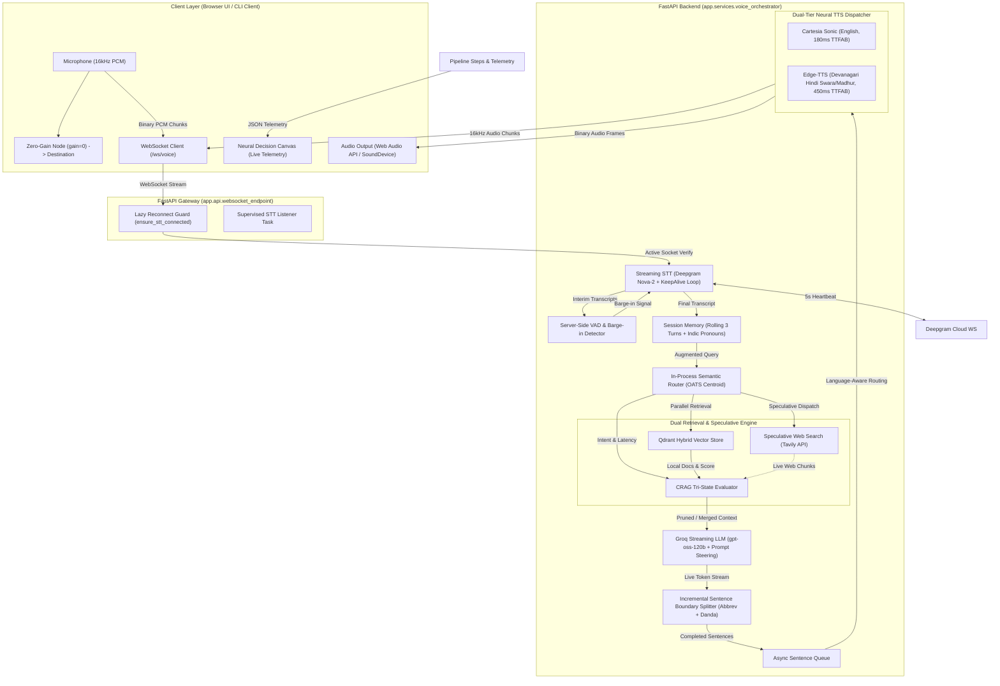
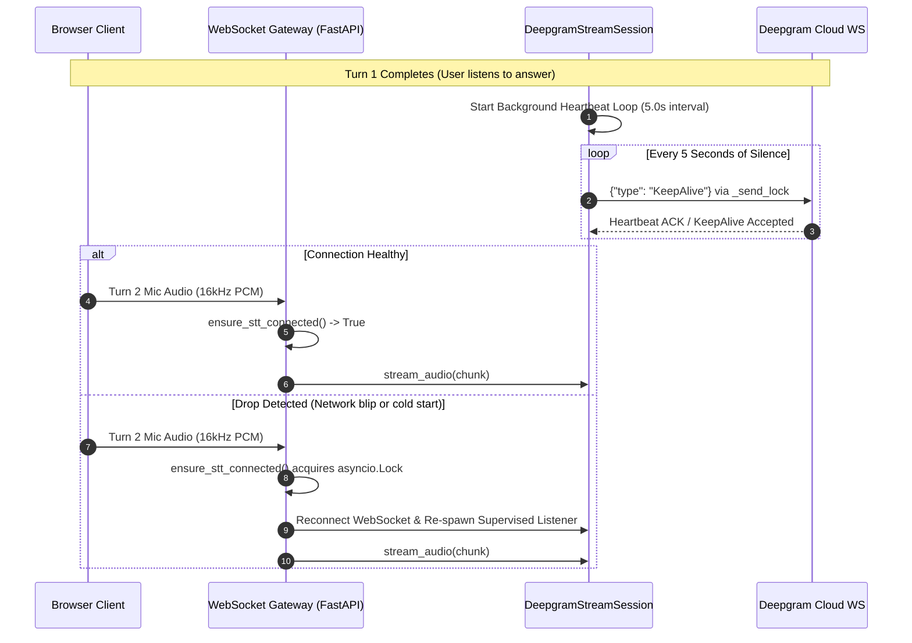
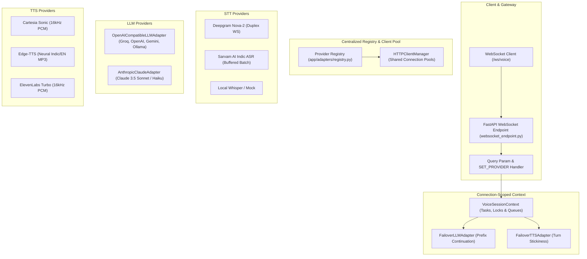

# Sahayak Voice Assistant — Architecture & System Design

Sahayak is an ultra-low latency, streaming Voice Retrieval-Augmented Generation (Voice RAG) assistant designed for Indian multilingual queries. It operates under a strict **sub-1.2s Time-to-First-Audio-Byte (TTFAB)** budget while delivering grounded answers for citizen welfare schemes, real-time news/weather, and general knowledge.

---

## 1. High-Level System Architecture

The system coordinates four decoupled, asynchronous streaming pipelines across WebSockets:



---

## 2. End-to-End Latency Budget

To maintain natural conversational rhythm without perceptible lag, every turn is constrained to an end-to-end budget:

```
0ms          100ms        200ms        300ms        400ms        500ms        600ms        700ms        800ms        900ms       1000ms       1100ms
├────────────┼────────────┼────────────┼────────────┼────────────┼────────────┼────────────┼────────────┼────────────┼────────────┼────────────┤
│ Deepgram   │ Router     │ Qdrant     │ Groq LLM TTFT (Time-To-First-Token)       │ Cartesia Sonic TTS TTFAB   │ User Hears First Audio     │
│ Final STT  │ (0.2ms)    │ Search     │                                           │ (180ms - 250ms)            │ Word at ~800ms - 1100ms    │
│ (~150ms)   │ + Spec     │ (35ms)     │                                           │                            │                            │
│            │ Dispatch   │            │                                           │                            │                            │
```

| Pipeline Component | Technology Stack | Latency Budget | Observed Benchmark (EN / HI) |
| :--- | :--- | :--- | :--- |
| **Speech-to-Text (Cloud)** | Deepgram Nova-2 Streaming (`en-IN` / `hi` / `multi`) | $< 250\text{ ms}$ | $120\text{ ms} - 180\text{ ms}$ |
| **Speech-to-Text (Indic)** | Sarvam AI Saaras Indic ASR | $< 350\text{ ms}$ | $200\text{ ms} - 320\text{ ms}$ |
| **Speech-to-Text (Offline)**| Faster-Whisper (CTranslate2 int8 CPU/GPU) | $< 300\text{ ms}$ | **$80\text{ ms} - 220\text{ ms}$** (RTF: $0.003\text{x}$) |
| **Intent Classification** | In-Process OATS Centroid Sparse Router | $< 1.0\text{ ms}$ | **$0.19\text{ ms} - 0.38\text{ ms}$** |
| **Vector DB Retrieval** | Qdrant Hybrid (Dense + Sparse BM25) | $< 60\text{ ms}$ | $27\text{ ms} - 55\text{ ms}$ |
| **Speculative Search Dispatch** | Non-blocking `asyncio.create_task` | $< 2.0\text{ ms}$ | **$0.8\text{ ms} - 1.2\text{ ms}$** |
| **LLM Time-To-First-Token** | Groq API (`openai/gpt-oss-120b` + prompt steering) | $< 800\text{ ms}$ | $580\text{ ms} - 790\text{ ms}$ |
| **Sentence Boundary Slicing** | Regex with Honorific & Danda (`।`) Guard | $< 0.1\text{ ms}$ | $0.05\text{ ms}$ |
| **TTS Time-To-First-Audio (EN)** | Cartesia Sonic 16kHz Linear PCM | $< 300\text{ ms}$ | **$180\text{ ms} - 240\text{ ms}$** |
| **TTS Time-To-First-Audio (HI)** | Edge-TTS Neural (`hi-IN-SwaraNeural` / `hi-IN-MadhurNeural`) | $< 600\text{ ms}$ | **$400\text{ ms} - 550\text{ ms}$** |
| **Audio Transmission** | Thread-Safe WebSocket Binary Stream | $< 10\text{ ms}$ | $2\text{ ms} - 5\text{ ms}$ |
| **Total Turn TTFAB (English)** | Speech Final $\to$ First Browser Audio Byte | **$< 1200\text{ ms}$** | **$790\text{ ms} - 1050\text{ ms}$** |
| **Total Turn TTFAB (Hindi)** | Speech Final $\to$ First Browser Audio Byte | **$< 1500\text{ ms}$** | **$1050\text{ ms} - 1280\text{ ms}$** |

---

## 3. Decoupled Pipeline & Task Concurrency

The orchestrator (`app/services/voice_orchestrator.py`) decouples generation and synthesis using Python's `asyncio` primitive channels:

1. **Producer Loop (`LLM Token Reader`)**:
   - Streams raw tokens from Groq API into a local sentence accumulator.
   - Executes non-destructive sentence boundary extraction.
   - Pushes completed clauses immediately into `sentence_queue: asyncio.Queue[Optional[str]]`.
   - Never halts or awaits audio synthesis; continues consuming LLM tokens at full generation speed (~60 tokens/sec).

2. **Consumer Loop (`TTS Synthesis Worker`)**:
   - Runs concurrently inside `active_tts_task = asyncio.create_task(self._tts_worker(...))`.
   - Pops the first completed sentence (e.g., $S_1$) from the queue.
   - Initiates streaming TTS synthesis before the LLM has even started generating sentence $S_2$.
   - Delivers binary PCM audio frames over WebSocket to the client.

3. **Sentinel Completion Signal**:
   - When the LLM stream completes, `None` is enqueued into `sentence_queue`.
   - The worker finishes synthesizing any remaining buffer, gracefully drains, and marks the turn completed.

---

## 4. Automatic Barge-In Cancellation

When the user speaks over the assistant while speech synthesis is active:
1. Deepgram STT emits an `interim` or `final` speech event.
2. `orchestrator.is_speaking()` evaluates to `True`.
3. `handle_user_interruption()` is immediately triggered:
   - `active_generation_task.cancel()` stops the LLM generation task.
   - `active_tts_task.cancel()` aborts in-flight TTS WebSocket requests.
   - Both tasks are awaited cleanly via `asyncio.gather(..., return_exceptions=True)`.
   - A `{"event": "CLEAR_AUDIO_BUFFER"}` control frame is transmitted over WebSocket.
   - The client Web Audio API immediately flushes its queued audio nodes, silencing output in $< 40\text{ms}$.
   - The partial assistant response is saved to `SessionMemory` marked with `was_interrupted=True`.

---

## 5. Multi-Turn Session Persistence & Inactivity Resilience

Voice sessions frequently encounter long inter-utterance pauses (e.g., a user listening to a 30-second explanation, reading on-screen information, or contemplating their next question). Default streaming STT connections silently terminate if no audio is streamed for 10-12 seconds (Deepgram code `NET-0001: Connection dropped due to inactivity`).

Sahayak guarantees continuous multi-turn session persistence through a resilient three-tier lifecycle:



### A. Proactive KeepAlive Heartbeat
- A background `_keepalive_loop` triggers every `keepalive_interval = 5.0s` inside `DeepgramStreamSession`.
- Sends `{"type": "KeepAlive"}` JSON messages serialized over `_send_lock: asyncio.Lock` to avoid frame interleaving with raw audio packets.
- Transparently holds open upstream Deepgram connections indefinitely across pauses without sending dummy audio energy that might pollute STT transcripts.

### B. Lazy Auto-Reconnection Guard (`ensure_stt_connected`)
- Every incoming binary PCM frame at `app/api/websocket_endpoint.py` is intercepted by `ensure_stt_connected(session)`.
- Implements double-checked locking using an `asyncio.Lock` to eliminate connection stampedes when audio chunks arrive at 50Hz.
- Inspects websocket connection health via `session.is_connected` (handling both modern `State.OPEN` and fallback attributes).
- Re-establishes the WebSocket session, restarts the supervised listener background task, and seamlessly begins transcription of the new utterance.

### C. Isolated Client Web Audio Graph
- In browser Web Audio environments, connecting `ScriptProcessorNode` to `audioContext.destination` is required by the browser event loop to continuously fire `onaudioprocess` callbacks.
- If routed directly, microphone input is mirrored through speakers, triggering acoustic feedback and corrupting STT recognition.
- Sahayak inserts a dedicated `GainNode` with `gain.value = 0` between the processor and `audioContext.destination`, capturing mic frames at full resolution while completely muting loopback.
- Active synthesis playback sources are registered in `state.currentAudioSource`, allowing `stopAudioPlayback()` to immediately cancel in-flight playback buffers when a subsequent user turn commences.

---

## 6. Pluggable Multi-Provider Architecture & Failover Chains

Sahayak v0.3.0 organizes providers into modular namespaces (`app/adapters/stt/`, `app/adapters/llm/`, `app/adapters/tts/`), managed by a centralized factory registry (`app/adapters/registry.py`) and connection-scoped session contexts (`VoiceSessionContext`):



### A. Connection-Scoped Concurrency (`VoiceSessionContext`)
To eliminate race conditions across concurrent WebSocket connections:
- Task handles (`active_generation_task`, `active_tts_task`), sentence queues, and WebSocket transmission locks (`ws_lock`) are connection-scoped.
- Cancellations during barge-in affect only the interrupting user's tasks, preventing cross-session speech cutoff.

### B. Tiered Failover with Prefix Continuation
- **LLM Prefix Continuation**: If a primary LLM (e.g., Groq) drops mid-stream after sentences $S_1, S_2$ were synthesized and delivered, `FailoverLLMAdapter` catches the error, parses `Retry-After`, and initiates prefix continuation:
  ```python
  messages = original_prompt + [
      {"role": "assistant", "content": completed_sentences},
      {"role": "user", "content": "Please continue and complete the previous thought or sentence directly from where you left off without repeating."}
  ]
  ```
  The fallback provider (e.g., Gemini Flash) generates only the remaining sentences without duplicating earlier speech.
- **Turn-Sticky TTS Fallback**: `FailoverTTSAdapter` ensures that once a sentence within a turn fails over to a secondary provider (e.g., Edge-TTS), subsequent sentences in that same dialogue turn stick to the fallback provider to avoid jarring voice changes.

---

## 7. Knowledge Base Ingestion & Grounded Seed Data

Sahayak provides an authoritative local knowledge base of key Indian citizen welfare schemes, stored under [`data/knowledge_base/`](../data/knowledge_base/):

| Dataset File | Scheme Name | Key Grounded Attributes |
| :--- | :--- | :--- |
| **`pm_kisan.json`** | PM-KISAN | ₹6,000/yr in 3 installments of ₹2,000, DBT bank transfer, landholding eligibility, tax-payer exclusions. |
| **`ayushman_bharat.json`** | AB-PMJAY | ₹5 lakh/family/year cashless healthcare, secondary/tertiary hospital care, SECC 2011 criteria, senior citizen expansion. |
| **`pm_awas_yojana.json`** | PMAY (Gramin & Urban) | Pucca house grants (₹1.20L plains / ₹1.30L hilly), CLSS interest subsidy, female head ownership requirement. |
| **`atal_pension_yojana.json`** | APY | Guaranteed ₹1,000 to ₹5,000/mo pension starting at age 60, entry age 18-40, PFRDA administration. |
| **`pm_ujjwala_yojana.json`** | PMUY (Ujjwala 2.0) | Deposit-free LPG connections for women in BPL households, ₹1,600 assistance, targeted cylinder subsidies. |
| **`sukanya_samriddhi_yojana.json`** | SSY | Small savings for girl child under 10 years, 8.2% compound interest, EEE tax benefits, 21-year maturity. |

### Ingestion Architecture (`scripts/ingest_knowledge.py`)
- **FastEmbed Embedding**: Generates 384-dimensional dense vectors using `BAAI/bge-small-en-v1.5` entirely on CPU in $<10\text{ms}$ per chunk.
- **Dual Invocation**:
  ```bash
  make ingest
  # Or: python scripts/ingest_knowledge.py
  # Or: python -m app.adapters.vector_store_qdrant --ingest
  ```
- **Concurrency & Lock Guard**: Local disk mode (`qdrant_storage/.lock`) uses exclusive file locking. The ingestion script detects if the local directory is locked by a running uvicorn instance and guides the user to either pause the server or target a standalone Qdrant container (`--url http://localhost:6333`).

---

## 8. Developer Tooling, Containerization & CI/CD

To ensure production stability and zero developer friction, Sahayak includes comprehensive automation:

### A. Developer Task Runner (`Makefile`)
Provides standard commands across the development lifecycle:
- `make dev`: Launches FastAPI uvicorn server with hot reload on port 8000.
- `make test`: Runs full automated pytest suite in isolated memory mode (`QDRANT_PATH=":memory:"`).
- `make ingest`: Indexes citizen welfare schemes into Qdrant.
- `make benchmark`: Runs TTFT and TTFAB latency benchmarking suite.
- `make lint`: Performs Ruff quality and undefined-variable checks.
- `make clean`: Cleans pycache, test caches, and temporary audio files.

### B. Containerization (`Dockerfile` & `docker-compose.yml`)
- **`Dockerfile`**: Lightweight image based on `python:3.12-slim-bookworm` containing system audio/codec packages (`portaudio`, `ffmpeg`, `libsndfile1`), curl healthcheck, and application code.
- **`docker-compose.yml`**: Deploys the FastAPI assistant alongside a standalone `qdrant/qdrant:latest` service with persistent volume storage (`qdrant_data`), eliminating local disk file-lock contention.

### C. Continuous Integration (`.github/workflows/ci.yml`)
Automated GitHub Actions pipeline triggered on every push and PR to `main`:
- Matrix testing across Python 3.11, 3.12, and 3.13 on `ubuntu-latest`.
- Installs audio dependencies (`ffmpeg`, `libportaudio2`, `portaudio19-dev`).
- Runs Ruff linting and the complete pytest test suite in memory.

---

## 9. Automated Latency Benchmarking Suite

Located at [`scripts/benchmark_providers.py`](../scripts/benchmark_providers.py), the automated benchmarking tool empirically validates voice pipeline performance against the **sub-1200ms TTFAB budget**:
- **Stage 1 (LLM Inference)**: Evaluates Time-to-First-Token (TTFT), streaming velocity (tokens/sec), and token distributions across Groq, OpenAI, Gemini, Claude, and Ollama.
- **Stage 2 (TTS Synthesis)**: Evaluates Time-to-First-Audio-Byte (TTFAB), audio byte throughput, and Real-Time Factor (RTF) across Cartesia, Edge-TTS, and ElevenLabs.
- **Stage 3 (Coupled Pipeline)**: Simulates the voice orchestrator's decoupled worker queue (sentence extraction $\to$ concurrent audio synthesis) and measures end-to-end voice budget adherence.
- Results are reported in colorized terminal ASCII tables and saved to [`docs/BENCHMARKS.md`](BENCHMARKS.md).

---

## 10. Event Loop-Aware Connection Pool Management

To ensure reliable operation across multiple event loops (e.g. in test runners, separate background tasks, or sub-processes):
- `HTTPClientManager`, `OpenAICompatibleLLMAdapter`, and `AnthropicClaudeAdapter` dynamically track the current running asyncio event loop (`asyncio.get_running_loop()`).
- If an existing client was bound to a closed or superseded event loop, the adapter lazily instantiates a fresh client for the active loop, eliminating `RuntimeError: Event loop is closed` failures.


