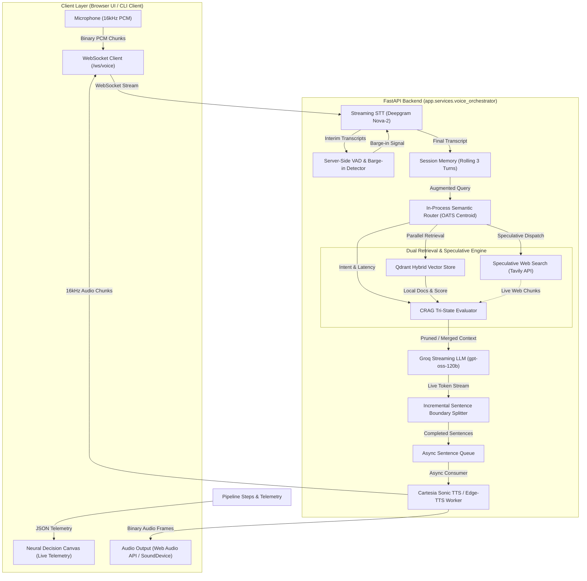

# Sahayak Voice Assistant — Architecture & System Design

Sahayak is an ultra-low latency, streaming Voice Retrieval-Augmented Generation (Voice RAG) assistant designed for Indian multilingual queries. It operates under a strict **sub-1.2s Time-to-First-Audio-Byte (TTFAB)** budget while delivering grounded answers for citizen welfare schemes, real-time news/weather, and general knowledge.

---

## 1. High-Level System Architecture

The system coordinates four decoupled, asynchronous streaming pipelines across WebSockets:



---

## 2. End-to-End Latency Budget

To maintain natural conversational rhythm without perceptible lag, every turn is constrained to an end-to-end budget:

```
0ms          100ms        200ms        300ms        400ms        500ms        600ms        700ms        800ms        900ms       1000ms       1100ms
├────────────┼────────────┼────────────┼────────────┼────────────┼────────────┼────────────┼────────────┼────────────┼────────────┼────────────┤
│ Deepgram   │ Router     │ Qdrant     │ Groq LLM TTFT (Time-To-First-Token)       │ Cartesia Sonic TTS TTFAB   │ User Hears First Audio     │
│ Final STT  │ (0.2ms)    │ Search     │                                           │ (180ms - 250ms)            │ Word at ~800ms - 1100ms    │
│ (~150ms)   │ + Spec     │ (35ms)     │                                           │                            │                            │
│            │ Dispatch   │            │                                           │                            │                            │
```

| Pipeline Component | Technology Stack | Latency Budget | Observed Benchmark |
| :--- | :--- | :--- | :--- |
| **Speech-to-Text (STT)** | Deepgram Nova-2 Streaming WebSocket | $< 250\text{ ms}$ | $120\text{ ms} - 180\text{ ms}$ |
| **Intent Classification** | In-Process OATS Centroid Sparse Router | $< 1.0\text{ ms}$ | **$0.19\text{ ms} - 0.38\text{ ms}$** |
| **Vector DB Retrieval** | Qdrant Hybrid (Dense + Sparse BM25) | $< 60\text{ ms}$ | $27\text{ ms} - 55\text{ ms}$ |
| **Speculative Search Dispatch** | Non-blocking `asyncio.create_task` | $< 2.0\text{ ms}$ | **$0.8\text{ ms} - 1.2\text{ ms}$** |
| **LLM Time-To-First-Token** | Groq API (`openai/gpt-oss-120b`) | $< 800\text{ ms}$ | $580\text{ ms} - 790\text{ ms}$ |
| **Sentence Boundary Slicing** | Regex with Honorific/Abbreviation Guard | $< 0.1\text{ ms}$ | $0.05\text{ ms}$ |
| **TTS Time-To-First-Audio** | Cartesia Sonic 16kHz Linear PCM | $< 300\text{ ms}$ | $180\text{ ms} - 240\text{ ms}$ |
| **Audio Transmission** | Thread-Safe WebSocket Binary Stream | $< 10\text{ ms}$ | $2\text{ ms} - 5\text{ ms}$ |
| **Total Turn TTFAB** | Speech Final $\to$ First Browser Audio Byte | **$< 1200\text{ ms}$** | **$790\text{ ms} - 1100\text{ ms}$** |

---

## 3. Decoupled Pipeline & Task Concurrency

The orchestrator (`app/services/voice_orchestrator.py`) decouples generation and synthesis using Python's `asyncio` primitive channels:

1. **Producer Loop (`LLM Token Reader`)**:
   - Streams raw tokens from Groq API into a local sentence accumulator.
   - Executes non-destructive sentence boundary extraction.
   - Pushes completed clauses immediately into `sentence_queue: asyncio.Queue[Optional[str]]`.
   - Never halts or awaits audio synthesis; continues consuming LLM tokens at full generation speed (~60 tokens/sec).

2. **Consumer Loop (`TTS Synthesis Worker`)**:
   - Runs concurrently inside `active_tts_task = asyncio.create_task(self._tts_worker(...))`.
   - Pops the first completed sentence (e.g., $S_1$) from the queue.
   - Initiates streaming TTS synthesis before the LLM has even started generating sentence $S_2$.
   - Delivers binary PCM audio frames over WebSocket to the client.

3. **Sentinel Completion Signal**:
   - When the LLM stream completes, `None` is enqueued into `sentence_queue`.
   - The worker finishes synthesizing any remaining buffer, gracefully drains, and marks the turn completed.

---

## 4. Automatic Barge-In Cancellation

When the user speaks over the assistant while speech synthesis is active:
1. Deepgram STT emits an `interim` or `final` speech event.
2. `orchestrator.is_speaking()` evaluates to `True`.
3. `handle_user_interruption()` is immediately triggered:
   - `active_generation_task.cancel()` stops the LLM generation task.
   - `active_tts_task.cancel()` aborts in-flight TTS WebSocket requests.
   - Both tasks are awaited cleanly via `asyncio.gather(..., return_exceptions=True)`.
   - A `{"event": "CLEAR_AUDIO_BUFFER"}` control frame is transmitted over WebSocket.
   - The client Web Audio API immediately flushes its queued audio nodes, silencing output in $< 40\text{ms}$.
   - The partial assistant response is saved to `SessionMemory` marked with `was_interrupted=True`.
