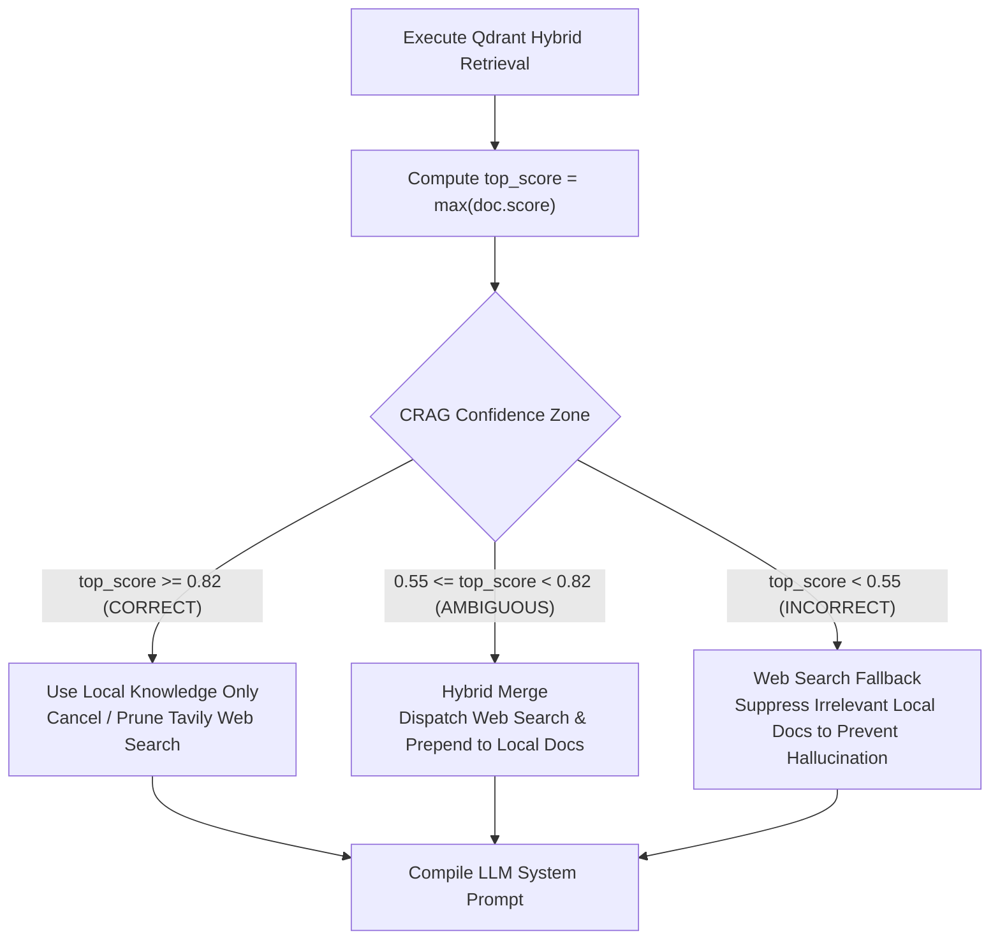

# Knowledge Retrieval & Corrective RAG (CRAG)

Retrieval-Augmented Generation (RAG) grounds assistant answers in factual documentation. However, in naive RAG systems, two severe failure modes routinely occur:
1. **Low-Confidence Hallucinations**: When the knowledge base lacks information for an out-of-domain query, it retrieves the "least bad" documents (e.g. cosine similarity 0.35) and forces the LLM to answer from them, resulting in fabricated or irrelevant responses.
2. **Redundant Search Overhead**: Blindly executing web search on every query adds 2–3 seconds of latency even when the local database already possesses authoritative facts.

To eliminate both pitfalls, Sahayak implements **Corrective Retrieval-Augmented Generation (CRAG)** based on *Corrective Retrieval Augmented Generation* (arXiv:2401.15884).

---

## 1. Qdrant Hybrid Retrieval Architecture

Sahayak integrates **Qdrant Vector Database** via [`app/adapters/vector_store_qdrant.py`](file:///Users/amankumar/Aman/project/sahayak-voice-assistant/app/adapters/vector_store_qdrant.py):

- **Vector Dimensions**: 384 dimensions (optimized for fast embedding models like `all-MiniLM-L6-v2` or `bge-small-en-v1.5`).
- **Distance Metric**: Cosine Similarity.
- **Hybrid Retrieval**: Combines dense semantic vector search with sparse lexical matching (BM25) to accurately match proper nouns, scheme acronyms (e.g. *PM-KISAN*, *AB-PMJAY*), and conversational queries.
- **Payload Schema**:
  ```json
  {
    "id": "doc-pm-kisan-01",
    "text": "Under the PM Kisan Samman Nidhi scheme...",
    "category": "agriculture_welfare",
    "score": 0.94
  }
  ```

---

## 2. CRAG Tri-State Confidence Arbitration

Rather than a binary threshold, CRAG partitions retrieval confidence into **three distinct operating zones**:

```
0.00                              0.55                              0.82                              1.00
├──────────────────────────────────┼──────────────────────────────────┼──────────────────────────────────┤
│           INCORRECT              │            AMBIGUOUS             │             CORRECT              │
│       (Score < 0.55)             │       (0.55 <= Score < 0.82)     │       (Score >= 0.82)            │
│  • Local knowledge absent        │  • Partial / outdated match      │  • Authoritative local facts     │
│  • Suppress local chunks         │  • Merge local background        │  • Prune external web search     │
│  • Web search mandatory          │    with live web search facts    │  • Minimal latency (~1.1s turn)  │
```



---

## 3. The Action Matrix in Detail

### State 1: `CORRECT` ($\ge 0.82$)
- **Condition**: Top retrieved local chunk has a cosine similarity $\ge 0.82$.
- **Interpretation**: The internal knowledge base contains authoritative, complete documentation.
- **Action**:
  - The local chunks are supplied directly to the LLM.
  - If a speculative web search was dispatched in parallel, it is **immediately cancelled** (`search_task.cancel()`).
- **Telemetry Event**: Emits `SPECULATIVE_SEARCH_CANCELLED` and `CRAG_DECISION: CORRECT`.

### State 2: `AMBIGUOUS` ($0.55 \le \text{Score} < 0.82$)
- **Condition**: Moderate relevance overlap (e.g. matching general keywords but missing specific rules or recent revisions).
- **Interpretation**: Local documentation provides baseline context, but may be incomplete or amended by new government notifications.
- **Action**:
  - Dispatches or awaits Tavily web search.
  - Concatenates web search results with local chunks: $\mathcal{D}_{\text{final}} = \mathcal{D}_{\text{web}} \cup \mathcal{D}_{\text{local}}$.
  - Supplies merged context to the LLM.
- **Telemetry Event**: Emits `CRAG_DECISION: AMBIGUOUS`.

### State 3: `INCORRECT` ($< 0.55$)
- **Condition**: Top similarity score is $< 0.55$ (e.g., query asks about sports trivia, world history, or an unindexed topic).
- **Interpretation**: Local database contains no relevant knowledge.
- **Action**:
  - **Suppresses local chunks entirely**: $\mathcal{D}_{\text{local}} = \emptyset$. This prevents the LLM from trying to answer a cricket question using agricultural scheme text.
  - Dispatches Tavily Web Search to fetch the actual answer from the internet.
  - Supplies only web results: $\mathcal{D}_{\text{final}} = \mathcal{D}_{\text{web}}$.
- **Telemetry Event**: Emits `CRAG_DECISION: INCORRECT`.

---

## 4. Fallback Knowledge Corpus & Dynamic Scoring

When running in local in-memory or embedded storage mode without an active Docker instance, [`QdrantVectorStoreAdapter`](file:///Users/amankumar/Aman/project/sahayak-voice-assistant/app/adapters/vector_store_qdrant.py) computes dynamic relevance scores over standard welfare scheme documentation:

1. **Token Filtering**: Strips conversational stopwords (`what`, `is`, `the`, `tell`, `me`, `about`).
2. **Lexical & Semantic Overlap**:
   - $\ge 2$ core term matches (e.g. `eligibility`, `pm`, `kisan`): Score assigned between **$0.78 - 0.95$**.
   - 1 term match: Score assigned **$0.65$** (Ambiguous).
   - 0 term matches: Score assigned **$0.30$** (Triggers CRAG `INCORRECT` fallback).

This ensures deterministic, testable behavior that accurately triggers each branch of the Corrective RAG pipeline.
