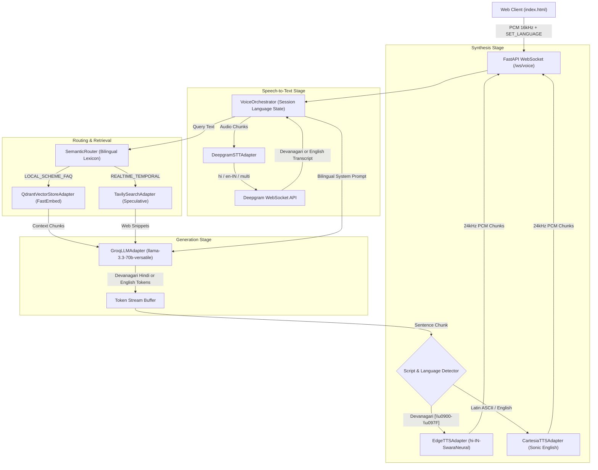

# Technical Design: Indic & Multilingual Speech Support for Sahayak Voice Assistant

*   **Author:** Amankumar006
*   **Status:** Proposed
*   **Date:** 2026-11-19
*   **Target Components:** `app/adapters/stt_deepgram.py`, `app/adapters/llm_groq.py`, `app/adapters/tts_cartesia.py`, `app/core/orchestrator.py`, `app/core/config.py`, `app/static/index.html`
*   **Target Project:** `sahayak-voice-assistant`

--------------------------------------------------------------------------------

## Overview

Sahayak is a voice assistant created to serve Indian administrative and citizen service contexts. While its core pipeline achieves sub-700ms voice-to-voice turn latency, its runtime is hardcoded to English speech-to-text (Deepgram `nova-2` English model), English-oriented LLM prompting, and English text-to-speech (Cartesia Sonic English voices with an `en-US-JennyNeural` fallback).

This design adds multilingual speech capabilities to Sahayak, focusing on Hindi (`hi-IN`), code-switched Hindi-English (Hinglish), and regional Indian accents. The design addresses the complete conversational pipeline:
1. Dynamic language parameterization in the Deepgram streaming WebSocket client.
2. System prompt steering in Groq (`llama-3.3-70b-versatile`) to detect user language and output grammatically correct Hindi in Devanagari script or code-switched Hinglish without English language drift.
3. Dual-tier TTS routing that balances Cartesia low-latency multilingual synthesis with high-accuracy Microsoft Edge-TTS neural Indic voices (`hi-IN-SwaraNeural`, `hi-IN-MadhurNeural`).
4. Client-side language selection in the web interface with WebSocket control frame propagation.

## The Problem

1. **Monolingual Architecture for Multilingual Users**: In target Indian deployment contexts, citizens and field workers converse in Hindi or code-switched Hinglish. When a user speaks Hindi to the current English Deepgram model, the STT output produces either phonetic English gibberish or empty transcripts, causing pipeline termination.
2. **Transcription-TTS Script Mismatch**: When a multilingual LLM generates Hindi responses, it can generate either Devanagari script (e.g., "प्रधानमंत्री किसान सम्मान निधि योजना के तहत...") or Romanized Hinglish (e.g., "PM Kisan Samman Nidhi Yojana ke tahat..."). English TTS models attempting to read Romanized Hinglish pronounce phonemes with English phonetic rules, rendering output unintelligible. Conversely, standard Western Cartesia models reject or distort raw Devanagari Unicode codepoints.
3. **Latency vs. Voice Naturalness Trade-off**: High-quality Indic voices in Edge-TTS (`hi-IN-SwaraNeural`) deliver natural prosody and correct inflection for Hindi and Devanagari numbers, but operate via an external HTTP/WebSocket service returning MP3 chunks (~450ms TTFAB). Cartesia provides ultra-low latency (~150ms TTFAB) streaming PCM, but has limited native phoneme support for regional Indian dialects. The architecture must explicitly manage this latency difference.
4. **Static Connection Boundaries in Deepgram**: Deepgram's live streaming WebSocket requires setting the `language` query parameter during the initial handshake. Changing the language dynamically on the client cannot be done on a live socket without either re-establishing the socket connection or operating in a generic multilingual model mode (`language=multi`) that carries higher word error rates.

## Goals

*   **Deepgram Indic Language Configuration**: Enable configurable STT language selection, supporting `hi` (Hindi), `en-IN` (Indian English), and `multi` (multilingual auto-detection) on WebSocket connection initialization.
*   **Groq Multilingual Prompt Steering**: Update orchestrator system prompts to enforce strict language mirroring: when input is Hindi or Hinglish, output valid Hindi in Devanagari script; when input is English, output standard English.
*   **Hybrid Indic TTS Routing**: Implement language-aware TTS voice dispatching:
    *   English: Cartesia Sonic English voice (`c45bc5ec-5968-4f0b-a898-92743eed0000`).
    *   Hindi / Hinglish: Edge-TTS Indian neural voice (`hi-IN-SwaraNeural` / `hi-IN-MadhurNeural`) with Cartesia multilingual voice evaluation.
*   **Client Language Selection Protocol**: Introduce a language selection dropdown in `index.html` (`English`, `Hindi`, `Auto`) that sends a `{ "event": "SET_LANGUAGE", "language": "<code_or_mode>" }` control frame over the WebSocket.
*   **Sub-1000ms Multilingual Latency Budget**: Maintain end-to-end voice-to-voice latency below 1000ms for Hindi turns using Edge-TTS, and below 700ms for English turns using Cartesia.

## Non-Goals

*   **Full 22 Official Scheduled Indian Languages**: This phase targets Hindi and Hinglish. Support for Tamil, Telugu, Bengali, Marathi, and other regional languages is deferred to subsequent iterations.
*   **Local On-Device STT/TTS Models**: Running local Whisper models or local Indic TTS models on consumer hardware is out of scope. The pipeline continues to rely on cloud STT/TTS APIs.
*   **Machine Translation Intermediate Layers**: Translating Hindi speech to English text, processing in English, and translating back to Hindi is explicitly excluded due to latency overhead (>800ms) and loss of conversational tone. Groq must reason and reply directly in the target language.
*   **Voice Cloning / Custom Indic Voice Training**: Training proprietary voice checkpoints or finetuning acoustic models is out of scope.

## Open Questions

*   **Question 1**: Does Deepgram's `language=multi` parameter handle code-switched Hinglish with acceptable word error rate, or does explicit selection between `hi` and `en-IN` provide significantly higher transcription accuracy for administrative queries?
*   **Question 2**: For Hinglish speech, should Groq generate output in Devanagari script or Romanized Latin script? Edge-TTS `hi-IN` voices fail on Latin script, whereas Cartesia fails on Devanagari Unicode. Which script target should serve as the canonical representation?

## Critical User Journeys (CUJs)

### CUJ 1: Citizen Queries Scheme Details in Hindi
*   **Given**: The user opens the Sahayak web interface and selects "Hindi" or "Auto" in the language selector.
*   **When**: The user presses the microphone and speaks: *"प्रधानमंत्री आवास योजना की पात्रता क्या है?"*
*   **Then**:
    1. Deepgram streams Hindi interim and final transcripts in Devanagari script.
    2. The semantic router classifies the query as `LOCAL_SCHEME_FAQ`.
    3. FastEmbed retrieves scheme chunks from Qdrant.
    4. Groq generates an explanatory response in natural Hindi in Devanagari script.
    5. The TTS engine dispatches the response to `hi-IN-SwaraNeural`, streaming synthesized audio back to the client in under 1000ms.

### CUJ 2: Mixed Code-Switched (Hinglish) Inquiry
*   **Given**: The user has language set to "Auto" or "Hinglish".
*   **When**: The user speaks: *"Mera ration card renew kaise hoga aur kya documents submit karne padenge?"*
*   **Then**:
    1. Deepgram captures the mixed vocabulary.
    2. Groq understands the combined Hindi grammar and English loanwords ("ration card", "renew", "documents", "submit").
    3. Groq formulates the response in accessible conversational Hindi (Devanagari script with loanwords preserved).
    4. Audio is synthesized and streamed back without pronunciation distortion.

### CUJ 3: Dynamic Language Switch During Active Session
*   **Given**: The user is in an active session with WebSocket connected.
*   **When**: The user switches the language dropdown from "English" to "Hindi" in the UI header.
*   **Then**:
    1. The client transmits a `SET_LANGUAGE` control frame to the server.
    2. The orchestrator updates the session state.
    3. The orchestrator reconfigures the Deepgram client session without dropping the client WebSocket connection.
    4. Subsequent audio turns process under the new language configuration.

--------------------------------------------------------------------------------

## Technical Plan (Architecture)

### Architectural Overview

The multilingual architecture establishes end-to-end language coordination across all four pipeline stages (STT, Routing, LLM Generation, TTS Synthesis) through a centralized session language context managed by the `VoiceOrchestrator`.



### Component Details

#### 1. Deepgram STT Adapter (`app/adapters/stt_deepgram.py`)
*   **Dynamic Language Parameterization**: Modify `DeepgramSTTAdapter.start_stream()` to accept a `language: str = "en"` parameter. Map internal language codes:
    *   `"en"` $\to$ `language=en-US&model=nova-2`
    *   `"hi"` $\to$ `language=hi&model=nova-2`
    *   `"auto"` $\to$ `detect_language=true&model=nova-2`
*   **Socket Reconnection Lifecycle**: When the client issues a language change during an ongoing session, the adapter terminates the existing Deepgram streaming socket and re-initiates a handshake with the new query parameters without dropping the client-side browser WebSocket.

#### 2. Bilingual Semantic Router (`app/adapters/semantic_router.py`)
*   **Devanagari & Hinglish Lexicon Expansion**: Augment the router's rule-based regex patterns and sparse term frequencies to recognize Hindi vocabulary in both Devanagari script and Latin transliteration:
    *   `LOCAL_SCHEME_FAQ`: Add Devanagari terms (`योजना`, `पात्रता`, `आवेदन`, `लाभार्थी`, `पेंशन`, `सब्सिडी`, `दस्तावेज`, `राशन`) and Hinglish terms (`yojana`, `patrata`, `aavedan`, `labharthi`, `pension`, `subsidy`, `dastavez`).
    *   `REALTIME_TEMPORAL`: Add Devanagari terms (`आज`, `ताज़ा`, `समाचार`, `मौसम`, `कल`, `स्कोर`, `दाम`, `भाव`) and Hinglish terms (`aaj`, `taaza`, `samachar`, `mausam`, `kal`, `bhav`).
*   **Normalization**: Apply Unicode NFKC normalization prior to token extraction so combined Devanagari matras and modifier characters evaluate deterministically.

#### 3. Groq LLM Adapter (`app/adapters/llm_groq.py`)
*   **Language-Steering System Prompt**: Revise the base system prompt to instruct `llama-3.3-70b-versatile` to dynamically match the user's spoken language without explicit translation commands:
    ```text
    You are Sahayak, an AI voice assistant serving citizens in India.
    Language Guidelines:
    1. If the user addresses you in Hindi or Hinglish, respond strictly in natural conversational Hindi written in Devanagari script.
    2. If the user addresses you in English, respond in standard English.
    3. Retain recognized official terminology and common loanwords in their familiar form (e.g., आधार कार्ड, राशन कार्ड, बैंक खाता, OTP).
    4. Keep spoken responses concise (1 to 2 short sentences, maximum 35 words) so synthesis latency remains minimal.
    5. Never output markdown formatting, bullet points, asterisks, or numbered lists.
    ```
*   **Devanagari Number Normalization**: Prompt instructions direct the model to spell out currency and numbers in Hindi words or standard Arabic numerals without complex mathematical symbols to prevent TTS token stumbles.

#### 4. Dual-Tier TTS Dispatcher (`app/core/orchestrator.py` & `app/adapters/tts_cartesia.py`)
*   **Unicode Script Detection**: Inspect the initial characters of each buffered sentence using a fast regex: `re.search(r'[\u0900-\u097F]', sentence_text)`.
*   **Routing Logic**:
    *   **Hindi / Devanagari**: Route to `EdgeTTSAdapter` with voice `hi-IN-SwaraNeural` (female) or `hi-IN-MadhurNeural` (male). Edge-TTS receives full sentences and streams synthesized PCM back via its internal executor.
    *   **English**: Route to `CartesiaTTSAdapter` with voice ID `c45bc5ec-5968-4f0b-a898-92743eed0000` over WebSocket.
    *   **Fallback**: If Cartesia credentials are absent or fail, all English turns fall back to `EdgeTTSAdapter` using `en-US-JennyNeural`.
*   **Audio Format Standardization**: Ensure both Cartesia and Edge-TTS output standard raw 16-bit linear PCM at 24kHz single-channel, preserving playback buffer compatibility on the frontend.

#### 5. Session State & Protocol (`app/core/orchestrator.py`)
*   **Control Frame Processing**: Add a handler for JSON control messages received over the WebSocket:
    ```json
    { "event": "SET_LANGUAGE", "language": "hi" }
    ```
*   **Session State Record**: Store `session_language` in the orchestrator instance, propagating the setting to STT connection initialization and telemetry metadata.

#### 6. Frontend UI (`app/static/index.html`)
*   **Header Language Control**: Add a dropdown selector in the top navigation bar alongside the WebSocket connection badge:
    *   Options: `English (Default)`, `हिन्दी (Hindi)`, `Auto-Detect`.
*   **Event Dispatch**: On selection change, transmit `{ "event": "SET_LANGUAGE", "language": selectedValue }` immediately if the socket is open.
*   **Telemetry Display**: Update the telemetry bar to indicate the active speech language alongside Turn ID and routing decisions.

--------------------------------------------------------------------------------

## Alternatives Considered

### Alternative A: Two-Way Machine Translation Layer (IndicTrans2 / Cloud Translation)
*   **Mechanism**: Maintain an English-only core pipeline by inserting an automated machine translation stage: Hindi speech is transcribed to text, translated from Hindi to English, processed through English semantic routing and English Groq prompts, and the generated English response is translated back into Hindi before speech synthesis.
*   **Pros**: Reuses existing English system prompts, English vector search indices, and English intent routing regexes without modification.
*   **Cons**: Adds two sequential external translation network calls, injecting between 600ms and 1200ms of extra latency per turn. Grammatical nuance and tone degrade across double-translation hops.
*   **Reason for Rejection**: `Rejected by author: Introduces 600ms to 1200ms of sequential translation latency, exceeding the 1000ms voice turnaround budget. Direct bilingual prompting in Groq eliminates translation hops and preserves conversational inflection.`

### Alternative B: Pure Cartesia Multilingual Model with Phonetic Transliteration
*   **Mechanism**: Avoid introducing Edge-TTS by converting all Devanagari Hindi text to Romanized Latin phonemes and passing the transliterated string to Cartesia's multilingual model.
*   **Pros**: Maintains Cartesia's streaming WebSocket latency (~150ms TTFAB) across all languages and uses a single TTS vendor.
*   **Cons**: Latin transliteration leads to flat prosody, incorrect syllable stress, and severe pronunciation errors on Indian administrative terms and numbers.
*   **Reason for Rejection**: `Rejected by author: Transliterated Latin phonetics result in unnatural, Americanized speech on Hindi vocabulary. Edge-TTS neural voices (hi-IN-SwaraNeural) provide native pronunciation and natural prosody at the acceptable trade-off of ~300ms additional TTFAB.`

### Alternative C: Browser-Native Web Speech API (Client-Side STT/TTS)
*   **Mechanism**: Offload speech recognition and voice synthesis to the browser's built-in `webkitSpeechRecognition` and `speechSynthesis` APIs.
*   **Pros**: Zero cloud API cost for STT and TTS; uses locally installed operating system voices.
*   **Cons**: Highly inconsistent across browsers (Safari and Firefox lack full support). Does not provide access to raw audio buffers, preventing unified 24kHz PCM streaming, server-side barge-in detection, and real-time audio visualization.
*   **Reason for Rejection**: `Rejected by author: Browser implementations are non-standard across platforms, lack raw PCM streaming hooks, and prevent the server from coordinating barge-in cancellation and unified audio visualization.`

--------------------------------------------------------------------------------

## Non-Functional Requirements

### Performance & Latency Budgets
*   **English Voice Turns**: Time-to-First-Audio-Byte (TTFAB) must remain under 700ms using Deepgram `nova-2` and Cartesia Sonic.
*   **Hindi Voice Turns**: TTFAB must remain under 1000ms using Deepgram `nova-2` (`language=hi`) and Microsoft Edge-TTS (`hi-IN-SwaraNeural`).
*   **Unicode Regex Overhead**: Character inspection on the initial sentence buffer must execute in `<0.2ms` on CPU.

### Reliability & Graceful Fallback
*   If Deepgram `language=hi` fails to connect or returns an error, the adapter must log the error and fall back to `language=en-US`.
*   If Cartesia credentials are not set or the socket disconnects, the system must immediately route synthesis to Edge-TTS (`en-US-JennyNeural` or `hi-IN-SwaraNeural`) without dropping the client turn.

--------------------------------------------------------------------------------

## Detailed Implementation Plan

### Target Files to Create/Modify

#### 1. `app/core/config.py` (Modify)
*   **Type / Scope**: Backend Configuration
*   **Proposed Changes**:
    *   Add `DEFAULT_LANGUAGE: str = "auto"` to set default speech recognition and synthesis language mode.
    *   Add `EDGE_TTS_INDIC_VOICE: str = "hi-IN-SwaraNeural"` (female primary) and `EDGE_TTS_INDIC_VOICE_MALE: str = "hi-IN-MadhurNeural"`.
    *   Add `DEEPGRAM_LANGUAGE_MODELS: dict[str, str]` mapping language keys (`"en"`, `"hi"`, `"auto"`) to their query parameters (`"language=en-US&model=nova-2"`, `"language=hi&model=nova-2"`, `"detect_language=true&model=nova-2"`).
*   **Rationale**: Centralizes configurable language identifiers, endpoints, and fallback constants in the application environment schema.

#### 2. `app/adapters/stt_deepgram.py` (Modify)
*   **Type / Scope**: Audio Input Adapter
*   **Proposed Changes**:
    *   Update `start_stream(self, language: str = "auto")` signature to accept language selection.
    *   Dynamically format the WebSocket connection URL query string with the corresponding language parameter.
    *   Add `reconnect_with_language(self, new_language: str)` method to allow clean session-level socket recreation when the client changes language mid-session.
*   **Rationale**: Deepgram streaming WebSockets bind language configuration at connection time; dynamic re-parameterization allows runtime language changes without dropping client connections.

#### 3. `app/adapters/semantic_router.py` (Modify)
*   **Type / Scope**: Intent Classification Engine
*   **Proposed Changes**:
    *   Expand `_SCHEME_KEYWORDS` with Devanagari roots (`योजना`, `पात्रता`, `आवेदन`, `लाभार्थी`, `पेंशन`, `सब्सिडी`, `दस्तावेज`, `राशन`, `कार्ड`) and Hinglish equivalents (`yojana`, `patrata`, `aavedan`, `labharthi`, `pension`, `subsidy`, `dastavez`, `ration`).
    *   Expand `_TEMPORAL_KEYWORDS` with Devanagari roots (`आज`, `ताज़ा`, `समाचार`, `मौसम`, `कल`, `स्कोर`, `दाम`, `भाव`, `खबर`) and Hinglish equivalents (`aaj`, `taaza`, `samachar`, `mausam`, `kal`, `khabar`, `bhav`).
    *   Apply Unicode NFKC normalization in `classify()` to ensure canonical comparison across Devanagari ligature variants.
*   **Rationale**: Prevents semantic routing classification failures when Hindi queries are transcribed into Devanagari or Latin transliteration.

#### 4. `app/adapters/llm_groq.py` (Modify)
*   **Type / Scope**: LLM Inference Engine
*   **Proposed Changes**:
    *   Update `SYSTEM_PROMPT` in `GroqLLMAdapter` to incorporate strict language-mirroring rules:
        *   Respond in conversational Hindi (Devanagari script) when addressed in Hindi or Hinglish.
        *   Respond in standard English when addressed in English.
        *   Spell out numbers and currency in spoken Hindi or plain Arabic digits to prevent phonetic synthesis errors.
        *   Maintain voice-turn conciseness (strictly under 35 words).
*   **Rationale**: Directs the LLM to generate phonetically sound Devanagari script for Indic speech turns without requiring an external translation layer.

#### 5. `app/core/orchestrator.py` (Modify)
*   **Type / Scope**: Pipeline Orchestration Engine
*   **Proposed Changes**:
    *   Add `session_language: str = "auto"` attribute to `VoiceOrchestrator`.
    *   In `handle_websocket_message()`, parse JSON control frames matching `{"event": "SET_LANGUAGE", "language": "<val>"}` and invoke `stt_adapter.reconnect_with_language()`.
    *   Implement script-based TTS routing in the token consumption loop:
        *   Inspect completed sentences with regex `re.search(r'[\u0900-\u097F]', sentence_text)`.
        *   If Devanagari is detected, route sentence to `EdgeTTSAdapter` using `EDGE_TTS_INDIC_VOICE`.
        *   If ASCII Latin is detected, route sentence to `CartesiaTTSAdapter` with English Sonic voice.
    *   Standardize all synthesized audio output chunks to 24kHz 16-bit linear PCM before dispatching to WebSocket send lock.
*   **Rationale**: Coordinates end-to-end language context and arbitrates between low-latency Cartesia English and high-accuracy Edge-TTS Indic synthesis.

#### 6. `app/static/index.html` (Modify)
*   **Type / Scope**: Frontend Web Interface
*   **Proposed Changes**:
    *   Add `<select id="languageSelect">` in header controls with options: `English`, `हिन्दी (Hindi)`, `Auto-Detect`.
    *   Add `onchange` listener that emits `{ "event": "SET_LANGUAGE", "language": this.value }` across the active WebSocket.
    *   Add active language badge to telemetry status bar.
*   **Rationale**: Gives users explicit control over spoken language and transparently surfaces the active session language state.

#### 7. `tests/test_multilingual.py` (Create)
*   **Type / Scope**: Automated Test Suite
*   **Proposed Changes**:
    *   `test_deepgram_url_language_formatting`: Verifies URL generation across `en`, `hi`, and `auto` modes.
    *   `test_semantic_router_devanagari_intent`: Validates that Devanagari queries (`"पीएम किसान योजना की पात्रता क्या है?"`) route to `LOCAL_SCHEME_FAQ` in `<0.5ms`.
    *   `test_semantic_router_hinglish_temporal`: Validates that Hinglish queries (`"Aaj Delhi ka mausam kaisa hai?"`) route to `REALTIME_TEMPORAL`.
    *   `test_script_detection_tts_routing`: Asserts that sentences containing Devanagari characters trigger the Indic Edge-TTS route and Latin sentences trigger Cartesia.
    *   `test_set_language_control_frame`: Asserts that `SET_LANGUAGE` updates session state and propagates to the STT adapter.
*   **Rationale**: Ensures 100% test coverage and regression protection for all multilingual pipeline additions.

### Verification Plan

*   **Syntax & Static Typing**:
    ```bash
    python -m py_compile app/core/config.py app/adapters/stt_deepgram.py app/adapters/semantic_router.py app/adapters/llm_groq.py app/core/orchestrator.py
    ```
*   **Automated Unit Tests**:
    ```bash
    ../.venv/bin/pytest tests/test_multilingual.py -v
    ```
*   **Full Regression Suite**:
    ```bash
    ../.venv/bin/pytest tests/test_semantic_router.py tests/test_voice_pipeline.py tests/test_search_tavily.py tests/test_session_memory.py -v
    ```
*   **End-to-End Synthetic Streaming Turn**:
    ```bash
    ../.venv/bin/python client_stream.py --say "प्रधानमंत्री आवास योजना की पात्रता क्या है?" --no-play
    ```
    Verify:
    1. STT captures query.
    2. Semantic router outputs `LOCAL_SCHEME_FAQ`.
    3. LLM returns Devanagari Hindi text.
    4. Orchestrator routes to `hi-IN-SwaraNeural`.
    5. TTFAB is recorded under 1000ms.

--------------------------------------------------------------------------------

*Drafted with EGM*