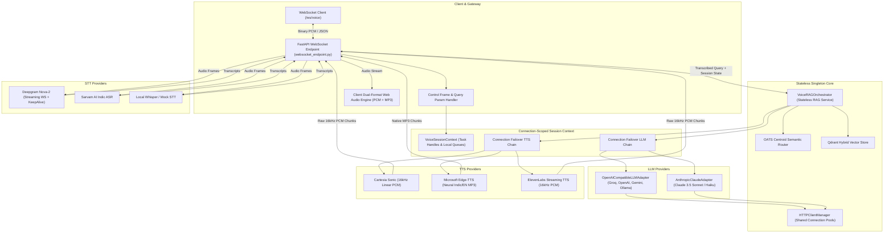
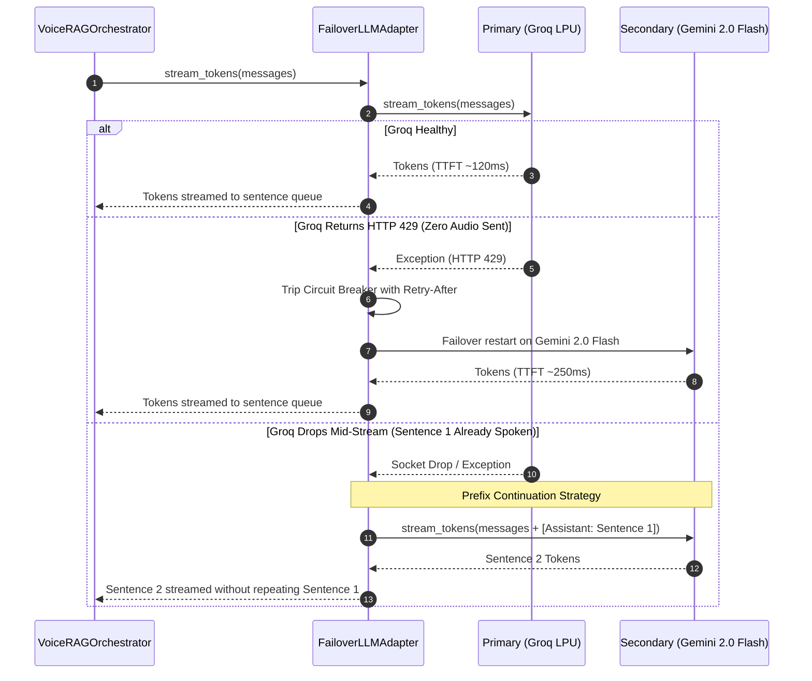

# Technical Design: Pluggable Multi-Provider Architecture for Voice RAG Pipeline

*   **Author:** Amankumar006
*   **Status:** In Review (Remediated Post-EGM Review)
*   **Date:** 2026-11-20
*   **Target Components:** `app/interfaces/adapters.py`, `app/adapters/` (`stt/`, `llm/`, `tts/`), `app/core/config.py`, `app/services/voice_orchestrator.py`, `app/api/websocket_endpoint.py`, `app/main.py`
*   **Target Project:** `sahayak-voice-assistant`

---

## Overview

Sahayak is a streaming Voice Retrieval-Augmented Generation (Voice RAG) assistant designed for sub-1.2s Time-to-First-Audio-Byte (TTFAB) performance across English and Indian multilingual citizen welfare queries.

Currently, the voice pipeline is coupled to specific third-party providers: Deepgram Nova-2 for Speech-to-Text (STT), Groq (`gpt-oss-120b`) for LLM token generation, and Cartesia Sonic with a Microsoft Edge-TTS fallback for speech synthesis. In addition, the orchestrator is instantiated as an application singleton whose mutable per-turn state creates cross-session race conditions when multi-session concurrency occurs.

This technical design establishes a pluggable Multi-Provider Model Framework across all core tiers of the pipeline:
1. Standardizes asynchronous streaming contracts (`AsyncGenerator`) for STT transcript events, LLM token streams, and synthesized audio chunks.
2. Implements a Provider Registry and Factory architecture supporting production cloud and offline local providers per tier (STT, LLM, TTS), consolidating LLM providers around an OpenAI-compatible streaming engine.
3. Decouples the orchestrator into connection-scoped session state, isolating tasks, queues, and provider selections to prevent cross-session task cancellations.
4. Establishes automated failover chains with prefix continuation to eliminate dead silence on mid-stream provider failures.
5. Enables connection-time and runtime provider selection with server-side whitelist authorization.
6. Introduces an offline local development profile (Ollama, local Whisper, Edge-TTS) alongside cloud profiles.
7. Preserves backward-compatible adapter shims to maintain existing test coverage during migration.

---

## The Problem

1. **Vendor Lock-In and Single Points of Failure**:
   The current gateway (`app/api/websocket_endpoint.py`) and bootstrap entrypoint (`app/main.py`) directly instantiate concrete classes (`DeepgramStreamSession`, `GroqLLMAdapter`, `CartesiaTTSAdapter`). If Groq encounters API rate limits (HTTP 429) or Deepgram suffers a network disruption, the voice assistant fails with unhandled exceptions.
2. **Singleton Concurrency Stomp Across Sessions**:
   `VoiceRAGOrchestrator` is initialized as a shared application singleton. It maintains mutable per-turn instance attributes (`self.active_generation_task`, `self.active_tts_task`, `self.sentence_queue`, `self.llm`, `self.tts`). If multiple clients connect concurrently, one client switching providers or triggering user barge-in cancels running tasks or mutates active models for other clients.
3. **STT Streaming vs. Batch REST Incompatibility**:
   The existing system assumes all speech models can stream bidirectional audio chunks over WebSockets. Cloud models such as Groq Whisper and OpenAI Whisper are non-streaming HTTP multipart REST endpoints (`/v1/audio/transcriptions`). Attempting to force batch REST models into a real-time streaming WebSocket contract without dedicated VAD buffering introduces 400ms–1500ms turnaround spikes or broken audio framing.
4. **Critical-Path Latency Risks from Server-Side Transcoding**:
   Inserting in-memory MP3 decoding and 24kHz-to-16kHz audio resampling onto the server's asyncio event loop adds 80ms–250ms of CPU overhead and bit-reservoir buffering jitter, threatening the sub-1.2s TTFAB budget. The client browser interface already possesses native dual-format decoding capability for both raw PCM and MP3.
5. **Geographic and Regional Dialect Limitations**:
   While Deepgram Nova-2 and Cartesia Sonic provide low latency in English, their coverage of regional Indian languages (Tamil, Telugu, Marathi, Bengali, rural Hindi dialects) is limited. Integrating specialized Indic models (such as Sarvam AI) requires flexible adapter interfaces.
6. **Developer Credential Friction**:
   Running automated unit tests, continuous integration (CI) pipelines, and local development currently requires active API keys for Deepgram, Groq, and Cartesia. Developers without commercial API keys cannot test the voice pipeline locally.

---

## Goals

*   **Uniform Component Protocols**: Formalize abstract interfaces in `app/interfaces/adapters.py` enforcing async streaming contracts:
    - `StreamingSTTProtocol`: `send_audio(chunk: bytes) -> None` and `receive_transcripts() -> AsyncGenerator[STTTranscriptEvent, None]` with `start()` / `connect()` and `close()`.
    - `BufferedBatchSTTAdapter`: VAD-gated audio accumulation for REST endpoints yielding `STTTranscriptEvent`.
    - `LLMClientProtocol`: `stream_tokens(messages: List[LLMMessage], **kwargs) -> AsyncGenerator[str, None]`.
    - `TTSClientProtocol`: `synthesize_stream(text: str, voice_override: Optional[str] = None) -> AsyncGenerator[bytes, None]`.
*   **Pruned, Lean Provider Matrix (2–3 per Tier)**:
    - **STT**:
      1. Deepgram Nova-2 (primary streaming cloud WebSocket with KeepAlive)
      2. Sarvam AI Indic ASR (regional Indian speech recognition)
      3. Local Whisper / Mock STT (offline local development)
    - **LLM**:
      1. `OpenAICompatibleLLMAdapter` (consolidates Groq LPU, OpenAI, Google Gemini via OpenAI endpoint, and Ollama/vLLM)
      2. Anthropic Claude (streaming completions via Anthropic SDK)
    - **TTS**:
      1. Cartesia Sonic (primary low-latency English 16kHz linear PCM)
      2. Microsoft Edge-TTS (Indian English and Devanagari Hindi neural voices without API credentials)
      3. ElevenLabs (streaming low-latency synthesis)
*   **Connection-Scoped Orchestrator State**: Isolate active tasks, queues, turn metrics, and provider overrides to the individual WebSocket connection lifecycle, eliminating cross-session concurrency collisions.
*   **Automated Failover with Prefix Continuation**: Implement fallback chains (`FailoverLLMAdapter`, `FailoverTTSAdapter`) that catch network errors, timeouts, and HTTP 429 rate limits. If failure occurs mid-stream after sentences were already spoken, pass completed sentences as assistant history prefix so the fallback provider continues seamlessly without silence or repetition.
*   **Zero-Transcoding Audio Pipeline**: Negotiate upstream 16kHz linear PCM where supported (Deepgram, ElevenLabs, Cartesia) and pass native MP3 frames directly from Edge-TTS to the client's dual-format Web Audio engine, avoiding server CPU transcoding overhead.
*   **Connection-Time Provider Negotiation**: Allow provider selection during the WebSocket connection handshake (`/ws/voice?llm=ollama&tts=edge`). For UI model switches, support a clean WebSocket reconnection (~30ms) or turn-boundary handoff with whitelist authorization.
*   **Backward-Compatible Migration**: Retain legacy adapter paths (`app/adapters/llm_groq.py`, etc.) as re-export shims, and update `app/main.py` bootstrap wiring to prevent breaking existing tests.
*   **Latency Budget Adherence**: Maintain the sub-1.2s end-to-end TTFAB voice budget on cloud provider configurations.

---

## Non-Goals

*   **Model Fine-Tuning and Training**: Training or fine-tuning models on domain datasets is out of scope.
*   **Real-Time Token Cost Bidding**: Dynamically routing tokens based on real-time spot API pricing auctions is out of scope.
*   **Arbitrary Subprocess Transcoding on Server**: Spawning `ffmpeg` or `pydub` subprocesses inside the server streaming loop is strictly prohibited.
*   **Modifying Intent Routing & Vector DB**: The in-process OATS semantic router and the Qdrant hybrid vector store remain unchanged.

---

## Open Questions & Architectural Resolutions

*   **Resolution 1 (STT Hot-Swapping vs. Handshake Negotiation)**:  
    *Decision:* Provider selection is primarily negotiated during the WebSocket connection handshake via query parameters (`/ws/voice?stt=deepgram&llm=groq&tts=cartesia`). If the user toggles a provider in the UI, the client cleanly closes and re-establishes the WebSocket connection (~30ms). If mid-session switching via `SET_PROVIDER` is invoked, the server defers STT teardown until `speech_final` is emitted, buffering pre-roll audio to prevent syllable drops.
*   **Resolution 2 (Mid-Stream Failover Policy)**:  
    *Decision:* If an LLM provider drops after emitting tokens but before any audio chunk is delivered to the client, the failover adapter cancels the request and restarts generation on the fallback LLM. If audio chunks for completed sentences were already dispatched to the client, the failover adapter initiates prefix continuation: it passes completed sentences as assistant history (`messages=[..., {"role": "assistant", "content": completed_sentences}]`) so the fallback LLM completes the remaining clauses without duplicating speech.
*   **Resolution 3 (Audio Normalization Strategy)**:  
    *Decision:* Upstream providers are configured to emit raw 16kHz linear PCM (`pcm_s16le`) directly. For Edge-TTS (which only emits MP3), chunks are passed directly to the client WebSocket; the browser client's existing dual-format Web Audio player (`app/static/index.html`) decodes MP3 chunks natively without server CPU transcoding overhead.

---

## Critical User Journeys (CUJs)

### CUJ 1: Voice Interaction with Default Cloud Providers
*   **Given**: Server is configured with default cloud keys (Deepgram, Groq, Cartesia).
*   **When**: User connects via WebSocket, starts streaming 16kHz audio, and asks a citizen scheme question.
*   **Then**: Audio streams to Deepgram Nova-2 STT; text tokens stream from Groq via `OpenAICompatibleLLMAdapter`; audio synthesizes via Cartesia Sonic TTS; client receives first audio byte in $< 1000\text{ms}$.

### CUJ 2: Dynamic Per-Session Provider Selection
*   **Given**: An active WebSocket session running on default providers.
*   **When**: Client connects with `/ws/voice?llm=gemini&tts=elevenlabs` or sends an authorized `SET_PROVIDER` frame at a turn boundary.
*   **Then**: Gateway validates the provider against the server whitelist, instantiates connection-scoped adapters, confirms with `{"event": "PROVIDER_CHANGED", ...}`, and routes the session through Gemini and ElevenLabs without cross-session interference.

### CUJ 3: Automated Failover with Prefix Continuation
*   **Given**: Primary LLM is configured as Groq with fallback to Gemini.
*   **When**: Groq API returns HTTP 429 (Rate Limit Exceeded) after Sentence 1 has been synthesized and spoken.
*   **Then**: Failover adapter catches the error, parses `Retry-After`, triggers prefix continuation with Sentence 1 as assistant context on Gemini, synthesizes Sentence 2 on the fallback, and completes the turn without dead silence or repetition.

### CUJ 4: Offline / Local Development Run
*   **Given**: Server is launched with `VOICE_PROFILE=local` and zero commercial API keys.
*   **When**: Developer connects client and speaks a query.
*   **Then**: Pipeline uses `LocalWhisperSTTAdapter` (or mock STT), routes to local Ollama (`llama3.2`) via `OpenAICompatibleLLMAdapter`, and synthesizes speech using Microsoft Edge-TTS without external network API calls.

---

## Technical Plan (Architecture)

### 1. High-Level Modular Architecture

The multi-provider architecture organizes adapters into namespaces (`app/adapters/stt/`, `app/adapters/llm/`, `app/adapters/tts/`), managed by centralized registries and instantiated with connection-scoped lifecycles:



---

### 2. Standardized Component Protocols (`app/interfaces/adapters.py`)

All provider implementations satisfy typed protocols utilizing Python's `typing.Protocol` and `AsyncGenerator`:

#### A. Speech-to-Text Protocols (`StreamingSTTProtocol` & `STTTranscriptEvent`)
```python
class STTTranscriptEvent(BaseModel):
    type: Literal["interim", "final"]
    text: str
    is_final: bool
    speech_final: bool
    confidence: float = 1.0
    language: Optional[str] = None

    def get(self, key: str, default: Any = None) -> Any:
        """Backward-compatibility accessor for dictionary-style lookups."""
        return getattr(self, key, default)

    def __getitem__(self, item: str) -> Any:
        return getattr(self, item)

class StreamingSTTProtocol(Protocol):
    @property
    def is_connected(self) -> bool:
        """Indicates whether upstream session is actively connected."""
        ...

    async def start(self) -> None:
        """Establishes upstream streaming session."""
        ...

    async def connect(self) -> None:
        """Alias for start()."""
        ...

    async def send_audio(self, chunk: bytes) -> None:
        """Transmits 16kHz linear mono PCM audio bytes."""
        ...

    async def receive_transcripts(self) -> AsyncGenerator[STTTranscriptEvent, None]:
        """Yields standardized interim and final transcript events."""
        ...

    async def close(self) -> None:
        """Gracefully terminates connection and releases resources."""
        ...
```

#### B. Large Language Model Protocol (`LLMClientProtocol`)
```python
class LLMMessage(BaseModel):
    role: Literal["system", "user", "assistant"]
    content: str

class LLMClientProtocol(Protocol):
    provider_name: str
    model_name: str

    @property
    def model(self) -> str:
        """Alias for model_name to preserve telemetry compatibility."""
        return self.model_name

    async def stream_tokens(
        self,
        messages: List[LLMMessage],
        temperature: float = 0.6,
        max_tokens: int = 1200,
        **kwargs: Any,
    ) -> AsyncGenerator[str, None]:
        """Yields string token fragments incrementally as received."""
        ...
```

#### C. Text-to-Speech Protocol (`TTSClientProtocol`)
```python
class TTSClientProtocol(Protocol):
    provider_name: str
    default_voice: str

    async def synthesize_stream(
        self,
        text: str,
        voice_override: Optional[str] = None,
        language: Optional[str] = None,
    ) -> AsyncGenerator[bytes, None]:
        """Yields synthesized audio chunks for a single sentence or clause in 16kHz
        mono linear PCM (or native MP3 for client-side decoding)."""
        ...
```

---

### 3. Consolidated OpenAI-Compatible LLM Engine

Rather than maintaining separate adapters for Groq, OpenAI, Gemini, and Ollama, a unified `OpenAICompatibleLLMAdapter` handles all OpenAI-spec streaming endpoints:

```python
class OpenAICompatibleLLMAdapter:
    def __init__(
        self,
        provider_name: str,
        base_url: str,
        api_key: Optional[str],
        model_name: str,
        client: Optional[AsyncOpenAI] = None,
    ):
        self.provider_name = provider_name
        self.base_url = base_url
        self.api_key = api_key or "local"
        self.model_name = model_name
        self.client = client or AsyncOpenAI(
            base_url=self.base_url,
            api_key=self.api_key,
            http_client=HTTPClientManager.get_client(),
        )

    async def stream_tokens(
        self,
        messages: List[LLMMessage],
        temperature: float = 0.6,
        max_tokens: int = 1200,
        **kwargs: Any,
    ) -> AsyncGenerator[str, None]:
        request_kwargs = {
            "model": self.model_name,
            "messages": [m.model_dump() for m in messages],
            "temperature": temperature,
            "max_tokens": max_tokens,
            "stream": True,
        }
        if "gpt-oss" in self.model_name or "reason" in self.model_name:
            request_kwargs["reasoning_format"] = "hidden"

        stream = await self.client.chat.completions.create(**request_kwargs)
        async for chunk in stream:
            if chunk.choices and chunk.choices[0].delta.content:
                yield chunk.choices[0].delta.content
```

---

### 4. Session-Scoped Orchestration & Concurrency Isolation

To resolve cross-session race conditions:
1. `VoiceRAGOrchestrator` is made **stateless regarding active task references**.
2. Connection-scoped state is maintained inside `VoiceSessionContext`:
```python
class VoiceSessionContext:
    def __init__(
        self,
        session_id: str,
        stt: StreamingSTTProtocol,
        llm: LLMClientProtocol,
        tts: TTSClientProtocol,
        indic_tts: Optional[TTSClientProtocol] = None,
        language: str = "en-IN",
    ):
        self.session_id = session_id
        self.stt = stt
        self.llm = llm
        self.tts = tts
        self.indic_tts = indic_tts
        self.language = language
        self.active_generation_task: Optional[asyncio.Task] = None
        self.active_tts_task: Optional[asyncio.Task] = None
        self.sentence_queue: asyncio.Queue[Optional[str]] = asyncio.Queue()

    async def cancel_active_turn(self) -> None:
        """Cancels in-flight generation and TTS tasks strictly for this connection."""
        tasks = [t for t in [self.active_generation_task, self.active_tts_task] if t and not t.done()]
        for t in tasks:
            t.cancel()
        if tasks:
            await asyncio.gather(*tasks, return_exceptions=True)
        self.active_generation_task = None
        self.active_tts_task = None
```
3. `VoiceRAGOrchestrator.process_voice_turn` accepts `(transcript, session_context, websocket)` and operates strictly on that session's tasks and queues.

---

### 5. Automated Failover Engine with Prefix Continuation



#### Circuit Breaker Rules:
1. **Dynamic Cooldown via `Retry-After`**: If an HTTP 429 provides a `Retry-After` header, the circuit breaker disables that provider for that exact duration (e.g. 5 seconds) rather than a rigid 60 seconds.
2. **Permanent Credential Disabling**: HTTP 401 Unauthorized or 403 Forbidden permanently marks the provider as `DISABLED_CREDENTIALS` until server reboot, eliminating retry penalties.
3. **Turn-Level TTS Stickiness**: If a fallback occurs during TTS synthesis for Sentence $K$, all subsequent sentences in that turn stay on the fallback provider to maintain voice consistency.

---

### 6. Configuration Architecture (`app/core/config.py`)

```python
class Settings(BaseSettings):
    # Active Profiles & Presets
    VOICE_PROFILE: str = "cloud"  # 'cloud' | 'local'
    ACTIVE_STT_PROVIDER: str = "deepgram"
    ACTIVE_LLM_PROVIDER: str = "groq"
    ACTIVE_TTS_PROVIDER: str = "cartesia"

    # Failover Policies
    FAILOVER_ENABLED: bool = True
    LLM_FAILOVER_CHAIN: List[str] = ["groq", "gemini", "openai"]
    TTS_FAILOVER_CHAIN: List[str] = ["cartesia", "elevenlabs", "edge"]

    # Provider Credentials & Models
    # STT
    DEEPGRAM_API_KEY: Optional[str] = None
    DEEPGRAM_MODEL: str = "nova-2"
    SARVAM_API_KEY: Optional[str] = None
    SARVAM_STT_MODEL: str = "saarika:v2"
    LOCAL_WHISPER_URL: str = "http://localhost:8080/inference"

    # LLM
    GROQ_API_KEY: Optional[str] = None
    GROQ_MODEL: str = "openai/gpt-oss-120b"
    OPENAI_API_KEY: Optional[str] = None
    OPENAI_MODEL: str = "gpt-4o-mini"
    ANTHROPIC_API_KEY: Optional[str] = None
    ANTHROPIC_MODEL: str = "claude-3-5-haiku-latest"
    GEMINI_API_KEY: Optional[str] = None
    GEMINI_MODEL: str = "gemini-2.0-flash"
    LOCAL_LLM_URL: str = "http://localhost:11434/v1"
    LOCAL_LLM_MODEL: str = "llama3.2"

    # TTS
    CARTESIA_API_KEY: Optional[str] = None
    CARTESIA_VOICE_ID: Optional[str] = None
    EDGE_VOICE: str = "en-IN-NeerjaNeural"
    EDGE_TTS_INDIC_VOICE: str = "hi-IN-SwaraNeural"  # Existing setting preserved
    ELEVENLABS_API_KEY: Optional[str] = None
    ELEVENLABS_VOICE_ID: str = "21m00Tcm4TlvDq8ikWAM"
    SARVAM_TTS_VOICE: str = "bulbul:v1"

    @property
    def TTS_PROVIDER(self) -> str:
        """Backward-compatibility alias for legacy code."""
        return self.ACTIVE_TTS_PROVIDER
```

---

## Alternatives Considered

### Alternative A: Adopting Third-Party Multi-Model Frameworks (e.g., LiteLLM, LangChain)

*   **Pros**: Pre-built wrappers for commercial LLM providers; unified API schemas.
*   **Cons**: Adds third-party dependencies and transitive packages; lacks low-latency streaming WebSocket implementations for STT and audio TTS; abstraction layers add 80ms–200ms of latency overhead, which risks exceeding the 1.2s latency budget.
*   **Reason for Rejection**: Custom pure-Python `typing.Protocol` implementations minimize runtime execution overhead and provide direct control over binary streaming chunks.

---

### Alternative B: Centralized External API Proxy Gateways (e.g., Portkey, Cloudflare AI Gateway)

*   **Pros**: Single billing account; centralized rate limit pooling and usage dashboards.
*   **Cons**: Adds an additional network round-trip hop (50ms–150ms) to every streaming token request, consuming 50ms–150ms of the latency budget on network transit; cannot terminate binary audio WebSockets.
*   **Reason for Rejection**: External routing proxies introduce network latency penalties on the critical path and cannot terminate real-time binary audio WebSockets.

---

### Alternative C: Server-Side In-Memory Audio Transcoding (`miniaudio` / `pydub`)

*   **Pros**: Standardizes all server output bytes into 16kHz linear PCM.
*   **Cons**: Mentions of `pydub` incur process-fork overhead; in-memory decoding of streaming MP3 chunks on the server CPU adds 80ms–250ms latency; redundant because the browser UI already supports dual-format decoding.
*   **Reason for Rejection**: Delivering native format streams (PCM from Cartesia/ElevenLabs, MP3 from Edge-TTS) directly to the client's dual-format player eliminates server transcoding latency completely.

---

## Detailed Implementation Plan

The implementation proceeds in five sequential phases, embedding tests into each phase and preserving backwards compatibility throughout.

### Phase 1: Dependencies, Core Protocols & Connection Lifecycles

1.  **`requirements.txt` (Modify)**
    *   *Action*: Update dependencies in place before writing importing code:
        ```text
        openai>=1.50.0
        anthropic>=0.36.0
        elevenlabs>=1.0.0
        soxr>=0.3.7
        audioop-lts>=0.2.1; python_version>='3.13'
        ```
2.  **`app/interfaces/adapters.py` (Modify)**
    *   *Action*: Define `STTTranscriptEvent` (with `.get()` and `__getitem__` backward-compatibility accessors), `StreamingSTTProtocol` (with `start()`, `connect()`, `send_audio()`, `receive_transcripts()`, `close()`), `LLMMessage`, `LLMClientProtocol` (with `model` alias property), and `TTSClientProtocol`.
3.  **`app/core/config.py` (Modify)**
    *   *Action*: Add typed settings for all providers while strictly preserving existing keys (`EDGE_TTS_INDIC_VOICE`, `TTS_PROVIDER` property alias). Add `VOICE_PROFILE: str = "cloud"`.
4.  **`app/adapters/base.py` (Create)**
    *   *Action*: Implement `HTTPClientManager` singleton providing shared `httpx.AsyncClient` connection pools across adapters.
5.  **`app/adapters/registry.py` (Create)**
    *   *Action*: Implement lightweight factory dispatchers (`get_stt_adapter`, `get_llm_adapter`, `get_tts_adapter`) backed by explicit dictionary mappings with credential validation.
6.  **`tests/test_registry.py` (Create)**
    *   *Action*: Validate that factory functions return protocol-compliant instances and raise `ConfigurationError` when API keys are absent.

### Phase 2: LLM Multi-Provider Suite & Prefix Failover

7.  **`app/adapters/llm/openai_compatible.py` (Create)**
    *   *Action*: Implement `OpenAICompatibleLLMAdapter` consolidating Groq, OpenAI, Google Gemini (via OpenAI compatibility endpoint), and Ollama/vLLM.
8.  **`app/adapters/llm/anthropic.py` (Create)**
    *   *Action*: Implement `AnthropicClaudeAdapter` streaming completions via `AsyncAnthropic`.
9.  **`app/adapters/llm_groq.py` (Modify - Deprecation Shim)**
    *   *Action*: Replace body with re-export shim: `from app.adapters.llm.openai_compatible import OpenAICompatibleLLMAdapter as GroqLLMAdapter`.
10. **`app/adapters/failover.py` (Create)**
    *   *Action*: Implement `FailoverLLMAdapter` with dynamic `Retry-After` cooldown, permanent 401/403 disable, and prefix continuation for mid-stream drops.
11. **`tests/test_llm_adapters.py` & `tests/test_llm_failover.py` (Create)**
    *   *Action*: Test streaming token generation with mock endpoints; verify failover to secondary on HTTP 429 and verify prefix continuation on mid-stream interruption.

### Phase 3: TTS Multi-Provider Suite & Failover

12. **`app/adapters/tts/cartesia.py` (Create)**
    *   *Action*: Implement Cartesia Sonic streaming 16kHz linear PCM over WebSocket.
13. **`app/adapters/tts/edge.py` (Create)**
    *   *Action*: Implement Microsoft Edge-TTS neural streaming for Indian English and Hindi.
14. **`app/adapters/tts/elevenlabs.py` (Create)**
    *   *Action*: Implement ElevenLabs streaming TTS configured for 16kHz linear PCM.
15. **`app/adapters/tts_cartesia.py` & `app/adapters/tts_edge.py` (Modify - Deprecation Shims)**
    *   *Action*: Retain re-export shims at legacy paths to keep existing tests green.
16. **`app/adapters/failover_tts.py` (Create)**
    *   *Action*: Implement `FailoverTTSAdapter` enforcing turn-level provider stickiness and voice timbre cross-mapping.
17. **`tests/test_tts_adapters.py` (Create)**
    *   *Action*: Verify Cartesia, Edge, and ElevenLabs adapters conform to `TTSClientProtocol` under mock streaming fixtures.

### Phase 4: STT Multi-Provider Suite

18. **`app/adapters/stt/deepgram.py` (Create)**
    *   *Action*: Implement Deepgram Nova-2 streaming WebSocket with 5-second `KeepAlive` heartbeat loop.
19. **`app/adapters/stt/sarvam.py` (Create)**
    *   *Action*: Implement Sarvam AI Indic streaming ASR for Indian regional languages.
20. **`app/adapters/stt/local_whisper.py` (Create)**
    *   *Action*: Implement `LocalWhisperSTTAdapter` (or mock streaming STT) supporting zero-credential local runs (`VOICE_PROFILE=local`).
21. **`app/adapters/stt_deepgram.py` (Modify - Deprecation Shim)**
    *   *Action*: Retain re-export shim: `from app.adapters.stt.deepgram import DeepgramStreamSession, DeepgramSTTAdapter`.
22. **`tests/test_stt_adapters.py` (Create)**
    *   *Action*: Test Deepgram, Sarvam, and Local Whisper adapters under simulated audio chunk streams.

### Phase 5: Session-Scoped Orchestrator, Gateway Wiring & Verification

23. **`app/services/voice_orchestrator.py` (Modify)**
    *   *Action*: Refactor orchestrator to accept `VoiceSessionContext` in `process_voice_turn()`. Isolate task cancellation to connection-scoped handles. Update `indic_tts` handling to support dynamic Indic provider overrides.
24. **`app/api/websocket_endpoint.py` (Modify)**
    *   *Action*: Instantiate connection-scoped `VoiceSessionContext` per client. Extract provider preferences from handshake query params (`/ws/voice?llm=...&tts=...`). Parse `SET_PROVIDER` frames with server whitelist validation and structured error responses.
25. **`app/main.py` (Modify)**
    *   *Action*: Update application bootstrap `create_app()` to initialize adapters via `get_stt_adapter()`, `get_llm_adapter()`, and `get_tts_adapter()`, wrapping them in failover composites.
26. **`app/static/index.html` (Modify)**
    *   *Action*: Add provider selection dropdowns to the top navbar. When changed, close and re-open the WebSocket connection with updated query parameters.
27. **`tests/test_multi_provider_pipeline.py` & `tests/test_failover_chains.py` (Create)**
    *   *Action*: End-to-end integration test verifying concurrent client sessions with different providers, verifying zero task cancellation collisions, and validating end-to-end failover.
28. **Documentation Updates (Modify)**
    *   *Action*: Update `docs/ARCHITECTURE.md`, `docs/STREAMING_AND_VOICE_PIPELINE.md`, `docs/TELEMETRY_AND_UI.md`, and `CHANGELOG.md` with multi-provider architecture specifications and latency benchmarks.
