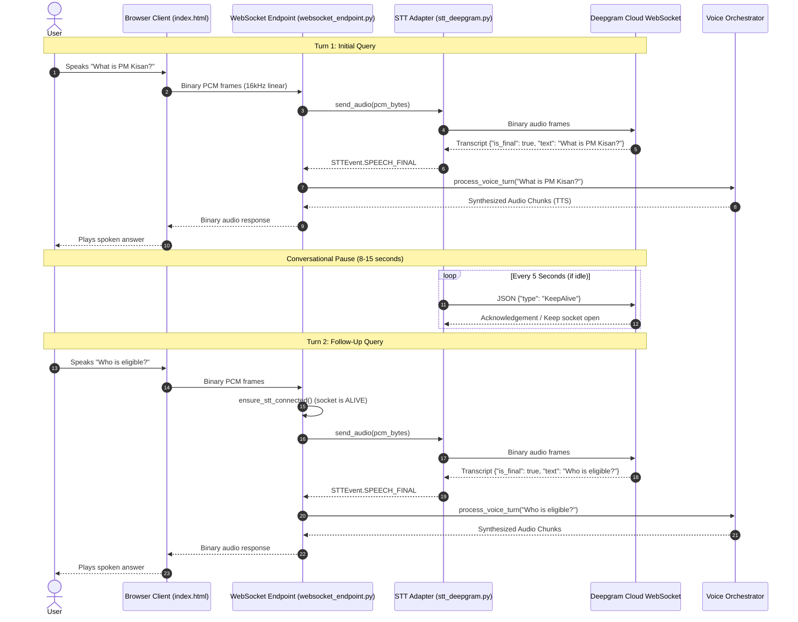

# Technical Design: Multi-Turn Voice Session Persistence & Audio Pipeline Fix

*   **Author:** Amankumar006
*   **Status:** Proposed
*   **Date:** 2026-11-19
*   **Target Components:** `app/adapters/stt_deepgram.py`, `app/api/websocket_endpoint.py`, `app/core/orchestrator.py`, `app/static/index.html`
*   **Target Project:** `sahayak-voice-assistant`

--------------------------------------------------------------------------------

## Overview

Sahayak is a real-time voice assistant designed for interactive citizen queries and administrative workflows. In interactive multi-turn conversations, users speak an initial question, receive a spoken response from the assistant, and follow up with consecutive questions through their microphone.

Currently, while single-turn queries succeed with sub-700ms voice-to-voice latency, consecutive microphone queries fail. After the user receives an answer to their first question, speaking a second question results in an indefinite hang: the client records and transmits audio, but no transcripts are recognized, no LLM inference triggers, and no synthesized audio returns.

This design establishes resilient multi-turn session persistence across the entire voice pipeline:
1. Continuous STT session health management with proactive heartbeat keep-alives and automatic reconnection for Deepgram streaming WebSockets.
2. Robust lifecycle management in the client-facing WebSocket endpoint to prevent dead-task silent audio drops.
3. Client-side microphone audio graph isolation to eliminate acoustic feedback loopbacks during playback.
4. State cleanup and previous-turn task cancellation within the voice orchestrator.

## The Problem

1. **Silent STT Socket Termination on Conversational Inactivity**: Deepgram streaming WebSockets enforce an aggressive server-side inactivity timeout (~10 to 12 seconds). When a user speaks a first query, the assistant replies with audio lasting 4 to 8 seconds. If the user pauses to process the answer before asking a second question, the Deepgram socket closes due to lack of inbound audio packets. `DeepgramStreamSession.receive_transcripts()` terminates and marks `_is_connected = False`.
2. **Dead STT Listener Task in API Endpoint**: In `app/api/websocket_endpoint.py`, `stt_listener_task` runs as a single background task listening on `session.receive_transcripts()`. Once the Deepgram connection terminates, the listener task exits. When the user speaks a second question, incoming binary audio frames sent to `session.send_audio(audio_bytes)` are silently dropped because `_is_connected` is `False`. The server logs no errors, leaving the user with an unresponsive UI.
3. **Absence of WebSocket Heartbeat (KeepAlive)**: Deepgram's streaming API specifies a `{"type": "KeepAlive"}` control message that preserves active session state during audio pauses. The adapter does not implement a keep-alive background task, making disconnection inevitable during natural conversational pauses.
4. **Browser Audio Echo and Direct Destination Routing**: In `app/static/index.html`, the audio processing node connects directly to `state.audioCtx.destination` (`processor.connect(state.audioCtx.destination)`). This causes microphone input to be echoed directly through the device speakers, creating acoustic feedback that confuses STT silence detection and voice activity markers.
5. **Orchestrator Concurrency Overwrite**: In `VoiceRAGOrchestrator`, if a user begins speaking while a prior turn's TTS generation or playback is still winding down, shared references to `self.sentence_queue` and `self.active_tts_task` can be overwritten without proper draining, causing queue deadlocks.

## Goals

*   **Multi-Turn Voice Persistence**: Support continuous, consecutive question-and-answer voice interactions over a single browser WebSocket session without requiring page refreshes or manual reconnections.
*   **Deepgram KeepAlive Heartbeat**: Maintain persistent Deepgram streaming WebSocket connections across conversational pauses by sending periodic `KeepAlive` control frames every 5 seconds.
*   **Automatic Lazy Reconnection**: If an STT streaming session disconnects due to network jitter or edge-case provider termination, automatically re-establish the STT session and its background listener task upon receiving new binary audio frames without dropping user speech.
*   **Acoustic Isolation in Browser Client**: Route microphone input through a muted gain node (`GainNode.gain.value = 0`) prior to destination connection in `index.html` to prevent local speaker loopback.
*   **Clean Turn Boundaries**: Ensure the orchestrator cleanly cancels pending TTS synthesis tasks and flushes residual queues whenever a new speech turn is detected.
*   **Sub-700ms Turn Latency Maintenance**: Ensure session health checks and keep-alives add zero latency overhead to active audio streaming and transcription.

## Non-Goals

*   **Offline/Local Voice Activity Detection (VAD)**: Replacing Deepgram's server-side endpointing (`endpointing=300`) with browser-side WebRTC VAD or local Silero VAD is out of scope for this iteration.
*   **Barge-In / Full-Duplex Simultaneous Interruption**: Implementing mid-sentence acoustic echo cancellation (AEC) and instant interruption handling while the assistant is actively speaking is deferred to a future milestone; this fix focuses on consecutive turn execution after assistant speech finishes.
*   **Multi-User Session Sharing**: Sharing audio streams or transcript sessions across multiple client connections is out of scope.

## Open Questions

*   **Question 1**: When an STT connection disconnects during an idle pause and requires reconnection, how much of the initial speech buffer should be cached to prevent clipping the first syllable while the WebSocket handshake completes?
*   **Question 2**: Should Deepgram's streaming session remain open for the entire duration of the browser connection (relying on `KeepAlive`), or should the session close after a configurable period of inactivity (e.g., 60 seconds) and reconnect on demand?

## Critical User Journeys (CUJs)

### CUJ 1: Consecutive Voice Questions via Web Interface

*   **Given**: The user has opened Sahayak in a browser, granted microphone access, and clicked "Start Listening".
*   **When**: The user speaks Question 1 ("What is PM Kisan scheme?"), listens to the 5-second audio answer, waits 8 seconds, and then speaks Question 2 ("Who is eligible for it?").
*   **Then**: Question 2 audio is received and recognized by Deepgram, the transcript displays on screen, the orchestrator generates a contextual response, and the second audio response streams back to the browser without any hanging or connection errors.

### CUJ 2: Recovery from Upstream STT Timeout

*   **Given**: A client is connected to Sahayak, and an upstream network drop or Deepgram maintenance closes the STT WebSocket while the user is silent.
*   **When**: The user presses the microphone button or resumes speaking.
*   **Then**: The backend endpoint detects that `_is_connected` is `False`, immediately re-establishes the Deepgram streaming connection, starts a new transcript listener, and processes the incoming speech without dropping the query.

--------------------------------------------------------------------------------

## Technical Plan (Architecture)

### Architectural Overview

The multi-turn persistence solution coordinates four layers:
1. **STT Stream Adapter (`app/adapters/stt_deepgram.py`)**: Implements an autonomous background heartbeat loop (`_keepalive_loop`) transmitting Deepgram-native `{"type": "KeepAlive"}` JSON messages every 5 seconds during periods of audio inactivity.
2. **WebSocket Session Gateway (`app/api/websocket_endpoint.py`)**: Manages the STT session lifecycle with lazy auto-reconnect semantics (`ensure_stt_connected()`). When binary audio frames arrive from the client, the gateway verifies session liveness, transparently re-establishing the Deepgram socket and transcript listener if upstream termination occurred.
3. **Voice RAG Orchestrator (`app/core/orchestrator.py`)**: Enforces clean turn boundary transitions. When a new speech segment triggers `process_voice_turn`, any residual TTS streaming tasks from prior turns are gracefully canceled and sentence queues are drained.
4. **Client Audio Pipeline (`app/static/index.html`)**: Isolates the microphone capture node via a zero-gain audio node (`GainNode.gain.value = 0`) before routing to the audio context destination, eliminating speaker feedback loops while maintaining active Web Audio event pumping.

### Sequence Flow Diagram



### Component Details

#### 1. Deepgram Streaming KeepAlive Heartbeat (`app/adapters/stt_deepgram.py`)

*   **Heartbeat Mechanism**: Within `DeepgramStreamSession`, initialize an `asyncio.Task` (`_keepalive_task`) upon successful connection.
*   **Timing**: A 5.0-second interval timer. On each tick, the loop checks the timestamp of the last transmitted audio packet (`self._last_audio_timestamp`). If more than 4.0 seconds have elapsed without audio transmission, it sends:
    ```json
    {"type": "KeepAlive"}
    ```
*   **Error Handling**: If sending the KeepAlive fails (e.g., `websockets.ConnectionClosed`), the loop sets `self._is_connected = False` and logs a warning.
*   **Graceful Teardown**: In `close()`, the keep-alive task is explicitly canceled (`self._keepalive_task.cancel()`) and awaited with exception suppression.

#### 2. Lazy Auto-Reconnection & Listener Supervision (`app/api/websocket_endpoint.py`)

*   **Session State Guard**: Introduce an async helper `ensure_stt_connected()` invoked prior to dispatching incoming binary audio packets.
*   **Reconnection Logic**:
    *   If `stt_session is None` or `not stt_session.is_connected`:
        1. Cancel existing `stt_listener_task` if running.
        2. Create a new session via `stt_adapter.create_stream_session(language=current_language)`.
        3. Await `stt_session.connect()`.
        4. Spawn fresh `stt_listener_task = asyncio.create_task(stt_event_listener(stt_session, ...))`.
*   **Transcript Listener Isolation**: Update `stt_event_listener` to cleanly exit without breaking the parent WebSocket connection if the upstream session closes.

#### 3. Voice RAG Orchestrator Concurrency & Queue Cleanup (`app/core/orchestrator.py`)

*   **Interrupted Turn Cleanup**: In `process_voice_turn()`:
    *   If `self.active_tts_task` is active and not done, trigger `self.active_tts_task.cancel()`.
    *   Drain `self.sentence_queue` to prevent queued sentences from prior turns from being synthesized or played.
    *   Re-initialize `self.sentence_queue = asyncio.Queue()` for the new turn.
*   **Metrics Reset**: Reset turn-level latency timers (`stt_final_time`, `first_token_time`, `first_audio_chunk_time`).

#### 4. Client-Side Audio Graph & Zero-Gain Destination (`app/static/index.html`)

*   **Acoustic Loopback Root Cause**: In standard Web Audio, connecting `processor.connect(state.audioCtx.destination)` routes live mic input directly to physical speakers, triggering acoustic feedback into the mic during playback.
*   **Zero-Gain Isolation**:
    ```javascript
    const zeroGain = state.audioCtx.createGain();
    zeroGain.gain.setValueAtTime(0, state.audioCtx.currentTime);
    processor.connect(zeroGain);
    zeroGain.connect(state.audioCtx.destination);
    ```
    This maintains the active destination connection required by the Web Audio specification to trigger `onaudioprocess` callbacks while ensuring complete silence is delivered to local output hardware.

--------------------------------------------------------------------------------

## Alternatives Considered

### Alternative A: Ephemeral Turn-Based STT Connection (Teardown & Reconnect)

*   **Mechanism**: Terminate the Deepgram WebSocket connection immediately upon receiving each `SPEECH_FINAL` transcript event or after TTS playback begins. Establish a brand-new Deepgram streaming WebSocket handshake when the user begins speaking the next turn.
*   **Pros**: Zero WebSocket traffic and zero idle connection resource utilization during assistant playback and conversational thinking pauses.
*   **Cons**: Introduces 150–250ms of connection handshake latency at the beginning of every follow-up question. Requires client-side pre-buffering of audio chunks to prevent clipping the first syllable of user speech while waiting for WebSocket handshake confirmation.
*   **Reason for Rejection**: Rejected by author: Adds unacceptable turn-onset latency (~200ms) to every follow-up question, degrading the sub-700ms voice-to-voice latency target, and introduces speech clipping edge cases during fast conversational turn-taking.

### Alternative B: Continuous Silent Audio Packet Pumping

*   **Mechanism**: Instead of utilizing Deepgram's JSON `{"type": "KeepAlive"}` protocol, continuously stream zero-byte PCM audio chunks (silence frames) through the WebSocket during conversational pauses.
*   **Pros**: Operates strictly within the binary audio stream interface without requiring multiplexed JSON control frames.
*   **Cons**: Deepgram bills for total audio duration streamed into the WebSocket, meaning silent audio is billed as active transcription minutes. Pumping synthetic silence can also confuse Deepgram's acoustic model and trigger spurious speech endpointing or hallucinated background noise tokens.
*   **Reason for Rejection**: Rejected by author: Unnecessarily increases cloud API usage costs by billing for idle silence minutes and risks injecting acoustic artifacts into Deepgram's speech endpointing engine.

### Alternative C: Browser-Side WebAssembly Voice Activity Detection (VAD) Gate

*   **Mechanism**: Load a client-side WebAssembly VAD engine (e.g., Silero VAD or WebRTC VAD) in the browser. Only open the server WebSocket and stream audio when speech confidence exceeds a threshold.
*   **Pros**: Completely prevents idle audio uploads from the browser to the backend server.
*   **Cons**: Adds a large WASM asset footprint (~3MB to 5MB) to client initial page load, consumes significant battery and CPU resources on low-end mobile devices, and does not solve the problem of keeping the backend-to-Deepgram upstream streaming connection alive while the user listens to the assistant.
*   **Reason for Rejection**: Rejected by author: Increases initial bundle size, degrades mobile client performance, and shifts complexity to the frontend without resolving the core backend STT inactivity timeout.

--------------------------------------------------------------------------------

## Non-Functional Requirements

### Performance & Latency
*   **Zero Impact on Turn-Taking Latency**: Sending `{"type": "KeepAlive"}` JSON control frames occurs only during idle pauses (>4.0s without audio) and consumes negligible bandwidth (<30 bytes per frame), adding 0ms latency to active speech streaming.
*   **Sub-700ms Turn 2 Voice-to-Voice Latency**: By keeping the Deepgram WebSocket alive across turns, follow-up questions achieve the same sub-700ms TTFT/TTFAB latency as the initial turn, completely bypassing WebSocket handshake overhead.

### Reliability & Resiliency
*   **Fail-Safe Self-Healing**: If an external network event or provider reset drops the Deepgram WebSocket despite keep-alive frames, the gateway automatically recovers on the next incoming binary frame via `ensure_stt_connected()`, preventing silent drop failures.
*   **Graceful Task Cancellation**: Active speech synthesis tasks from prior turns are cleanly cancelled without leaving hanging async generators or unhandled `asyncio.CancelledError` exceptions in the event loop.

### Security & Privacy
*   **Audio Data Boundary**: Audio frames and transcripts remain ephemeral in-memory buffers; neither KeepAlive packets nor intermediate audio chunks are persisted to disk.

--------------------------------------------------------------------------------

## Detailed Implementation Plan

### Phasing & Checkpoints

*   **Phase 1: STT Stream Adapter (`app/adapters/stt_deepgram.py`)**:
    *   Implement KeepAlive loop with send lock synchronization, idle timestamp tracking, and `is_connected` property for both `DeepgramStreamSession` and `MockDeepgramStreamSession`.
    *   *Checkpoint*: Run `pytest tests/test_adapters.py` to verify adapter tests pass.
*   **Phase 2: Core Voice Orchestrator (`app/services/voice_orchestrator.py`)**:
    *   Implement clean turn boundary cancellation for both `active_generation_task` and `active_tts_task`, along with sentence queue re-initialization.
    *   *Checkpoint*: Run `pytest tests/test_orchestrator.py` to verify orchestrator lifecycle.
*   **Phase 3: WebSocket Gateway Endpoint (`app/api/websocket_endpoint.py`)**:
    *   Implement `ensure_stt_connected()` guarded by `stt_reconnect_lock = asyncio.Lock()`, maintain message receive multiplexing, and isolate `stt_event_listener`.
    *   *Checkpoint*: Test live connection with `pytest tests/test_websocket.py`.
*   **Phase 4: Client Web Audio Isolation (`app/static/index.html`)**:
    *   Route microphone capture through a zero-gain node (`GainNode.gain.value = 0`) before connecting to destination, track `state.currentAudioSource`, and implement `stopAudioPlayback()`.
    *   *Checkpoint*: Manual verification in browser to ensure zero speaker loopback and responsive turn taking.
*   **Phase 5: Regression & Multi-Turn Integration Tests (`tests/test_cli_client.py`)**:
    *   Add multi-turn test validating consecutive turns with an 11-second pause between turns.
    *   *Checkpoint*: Full test suite execution `pytest` and CLI benchmark `client_stream.py --benchmark --no-play`.

---

### Target Files to Create/Modify

#### 1. `app/adapters/stt_deepgram.py` (Modify)

*   **Type / Scope**: Backend STT Adapter Module
*   **Rationale**: Implement persistent connection heartbeat, send synchronization, and session health tracking.
*   **Changes**:
    *   Add `import time` at the top of the module.
    *   In `DeepgramStreamSession`:
        *   Add `self._last_audio_timestamp: float = time.time()` in `__init__`.
        *   Update `send_audio(audio_chunk: bytes)` to refresh `self._last_audio_timestamp = time.time()`.
        *   Add `_keepalive_loop()` coroutine: while `self._is_connected`, sleeps for 1.0 second. If `time.time() - self._last_audio_timestamp >= 4.0`, acquires `async with self._send_lock:` and transmits `json.dumps({"type": "KeepAlive"})`. Catches `websockets.exceptions.ConnectionClosed`, `OSError`, and logs warning, setting `self._is_connected = False`.
        *   In `start()`: spawn `self._keepalive_task = asyncio.create_task(self._keepalive_loop())`.
        *   In `close()`: cancel `self._keepalive_task` prior to transmitting `CloseStream` and suppress `asyncio.CancelledError`.
        *   Add property `is_connected -> bool` returning `self._is_connected and self._ws is not None and not self._ws.closed`.
    *   In `MockDeepgramStreamSession`:
        *   Add property `is_connected -> bool` returning `self._is_connected`.

#### 2. `app/services/voice_orchestrator.py` (Modify)

*   **Type / Scope**: Core Voice Orchestrator Service
*   **Rationale**: Ensure clean turn transitions, cancel stale LLM generation and TTS synthesis tasks, and prevent queue deadlocks during conversational turns.
*   **Changes**:
    *   In `VoiceRAGOrchestrator.process_voice_turn()`:
        *   Before initiating a new turn, cancel both `self.active_generation_task` and `self.active_tts_task` if running:
            ```python
            tasks_to_cancel = []
            if self.active_generation_task and not self.active_generation_task.done():
                self.active_generation_task.cancel()
                tasks_to_cancel.append(self.active_generation_task)
            if self.active_tts_task and not self.active_tts_task.done():
                self.active_tts_task.cancel()
                tasks_to_cancel.append(self.active_tts_task)
            if tasks_to_cancel:
                await asyncio.gather(*tasks_to_cancel, return_exceptions=True)
            ```
        *   Re-initialize `self.sentence_queue = asyncio.Queue()` to clear any residual items.
        *   Initialize `tracker = TurnTracker(turn_id)` for the incoming query.

#### 3. `app/api/websocket_endpoint.py` (Modify)

*   **Type / Scope**: FastAPI WebSocket Gateway
*   **Rationale**: Manage STT lifecycle, supervise background transcript listeners with stampede locks, and guarantee lazy reconnection upon speech arrival without breaking message multiplexing.
*   **Changes**:
    *   Define `stt_reconnect_lock = asyncio.Lock()` in `voice_websocket`.
    *   Implement async helper `ensure_stt_connected()`:
        ```python
        async def ensure_stt_connected() -> None:
            nonlocal session, stt_listener_task
            if session and session.is_connected:
                return
            async with stt_reconnect_lock:
                if session and session.is_connected:
                    return
                if stt_listener_task and not stt_listener_task.done():
                    stt_listener_task.cancel()
                    try:
                        await stt_listener_task
                    except asyncio.CancelledError:
                        pass
                if session:
                    await session.close()
                session = orchestrator.stt.create_stream_session(language=current_language)
                await session.start()
                stt_listener_task = asyncio.create_task(stt_event_listener(session))
        ```
    *   In the multiplexed message receiver (`message = await websocket.receive()`):
        *   Within the binary branch `if "bytes" in message and message["bytes"]:`:
            *   Await `ensure_stt_connected()`.
            *   If `session`: await `session.send_audio(audio_bytes)`.
    *   Update `stt_event_listener(active_session)` to accept the active session explicitly and cleanly catch disconnect exceptions without crashing the client WebSocket.

#### 4. `app/static/index.html` (Modify)

*   **Type / Scope**: Web UI Client
*   **Rationale**: Isolate the microphone capture node to eliminate speaker loopback and manage audio playback buffers across turns.
*   **Changes**:
    *   In the audio processing initialization block:
        *   Create and route through a zero-gain node:
            ```javascript
            const zeroGain = state.audioCtx.createGain();
            zeroGain.gain.setValueAtTime(0, state.audioCtx.currentTime);
            state.micGainNode = zeroGain;
            processor.connect(zeroGain);
            zeroGain.connect(state.audioCtx.destination);
            ```
    *   In `stopMicrophone()`: disconnect `state.micGainNode`.
    *   In `playNextAudioChunk()`: track `state.currentAudioSource = source`, and reset to `null` in `source.onended`.
    *   Add `stopAudioPlayback()`:
        ```javascript
        function stopAudioPlayback() {
          state.audioPlaybackQueue = [];
          if (state.currentAudioSource) {
            try { state.currentAudioSource.stop(); } catch(e) {}
            state.currentAudioSource = null;
          }
          state.isPlayingAudio = false;
          const statusText = document.getElementById("audioStatusText");
          if (statusText) statusText.innerText = "Audio Output: Idle";
        }
        ```
    *   Call `stopAudioPlayback()` in `startMicrophone()`, `toggleMicrophone()`, and upon receiving `CLEAR_AUDIO_BUFFER`.

#### 5. `tests/test_adapters.py` (Modify)

*   **Type / Scope**: Unit Test Suite
*   **Rationale**: Verify keepalive task lifecycle, timing, and teardown in `DeepgramStreamSession` using mocks.
*   **Changes**:
    *   Add mock tests using `unittest.mock.AsyncMock` on `websockets.connect`.
    *   Verify `_keepalive_task` is created upon `start()` and canceled upon `close()`.
    *   Verify `{"type": "KeepAlive"}` is dispatched when idle time exceeds threshold.
    *   Verify `is_connected` reflects WebSocket connection state on both real and mock sessions.

#### 6. `tests/test_cli_client.py` (Modify)

*   **Type / Scope**: End-to-End Streaming Test Suite
*   **Rationale**: Validate consecutive multi-turn voice queries across simulated pauses.
*   **Changes**:
    *   Add test simulating two consecutive question audio streams with an 11-second pause between turns using `@pytest.mark.skipif(not settings.DEEPGRAM_API_KEY or not settings.GROQ_API_KEY)`.
    *   Assert that Turn 2 receives a final transcript (`len(metrics["transcript"]) > 0`) and synthesizes audio (`metrics["total_audio_bytes"] > 0`) without timeouts.
